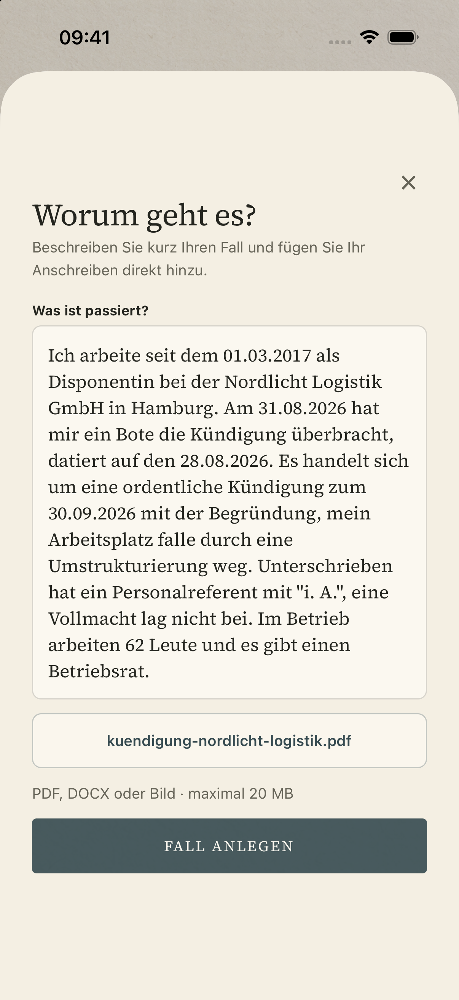
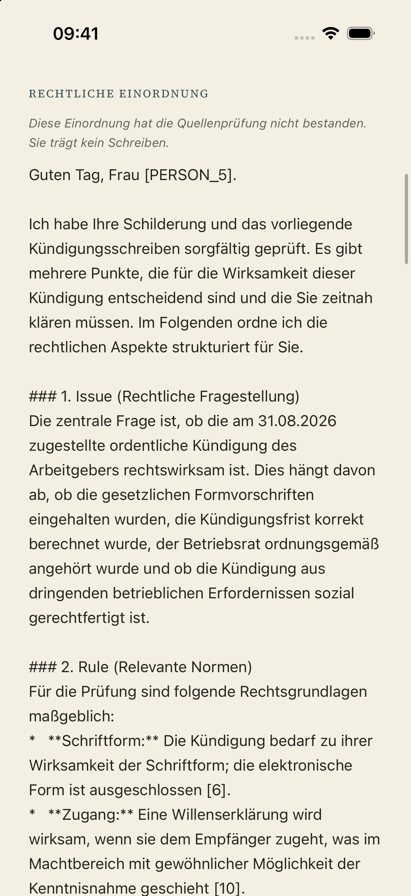
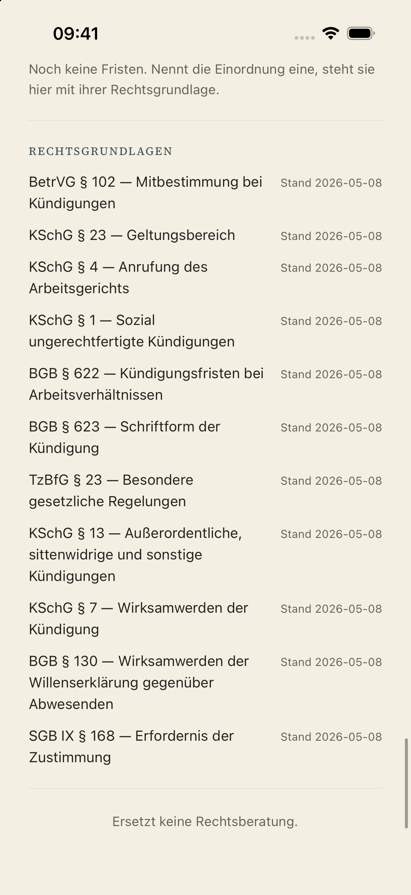
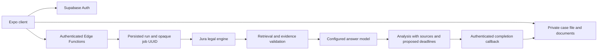

# Recht & Papier — Case-file application with a legal RAG integration

An Expo/React Native application for collecting a case, attaching documents and reviewing source-backed analysis. The case file is the data model; chat is an interface over it.

This repository demonstrates the client, authentication and case-data boundary, Supabase migrations and Edge Functions. The retrieval/reranking engine is a **separate service in [Jura](https://github.com/dreamtelligence/Jura)**; access to that repository is separate. This repository alone does not contain the full RAG engine or its legal corpus.

## iOS walkthrough

Captured from the native iOS Simulator on 10 November 2026, using the fictional dismissal fixture in [`docs/beispielfaelle/`](docs/beispielfaelle/). The August/September dates belong to a historical test case.

| Start | Describe the case and attach a PDF |
| --- | --- |
| <a href="docs/screenshots/01-start.png"></a> | <a href="docs/screenshots/02-fall-beschreiben.png"></a> |
| **Generated analysis — release blocked** | **Retrieved legal sources** |
| <a href="docs/screenshots/03-pruefsperre.png"></a> | <a href="docs/screenshots/04-rechtsgrundlagen.png"></a> |

The real background run returned 202 in 2.9 seconds and persisted an answer with 11 sources after about seven minutes. **Its answer audit failed, so document generation and deadline creation stayed blocked.** These images demonstrate the actual workflow and its rejection state; they do not demonstrate a legally validated answer. See [capture notes and remaining gaps](docs/screenshots/README.md).

## Engineering focus

- Expo SDK 57, React Native 0.86, TypeScript and Expo Router.
- Session-based navigation with one protected application route group.
- Structured cases, private document storage, analyses, sources and deadlines.
- Supabase Row Level Security binds case data to its owner.
- Edge Functions validate the user, resolve ownership and call the engine with server-only credentials.
- Background case analysis with persisted input snapshots, worker claim deduplication and bounded leases.
- Pseudonymization, model allowlisting, request identifiers and atomic audit/source persistence.
- Account deletion explicitly removes stored documents before deleting the account.
- Integration checks cover isolation between users, account deletion, document release and analysis writes.

## Data flow



The case view polls the saved status while analysis runs; the start request returns HTTP 202. See [job lifecycle, security boundaries and deployment](docs/analysis-jobs.md).

The client never receives the engine credential. Public legal-source data and private case data are separate. `apps/mobile/src/features/legal/client.ts` is the client boundary; `supabase/functions/fall-einordnen/index.ts` handles the case-analysis request.

## Check the source without production credentials

Node.js 24 is used in CI:

```bash
cd apps/mobile
npm ci
npm run typecheck
```

This verifies client types, not a native build or a live legal answer. GitHub Actions runs this check on pushes and pull requests.

## Local setup

1. Use your own Supabase project, or the Supabase CLI local stack. Apply the migrations in `supabase/migrations/` and configure the private document bucket and Edge Functions.
2. Copy `.env.example` to `.env` for local tooling, and `apps/mobile/.env.example` to `apps/mobile/.env.local` for the client. Keep service-role and engine credentials on the server.
3. Configure a compatible Jura engine and the model allowlist in the Edge Functions. The model must agree with the deployment and its disclosed data flow; provider names in older status documents are historical snapshots.
4. Install client dependencies and create a native development build:

```bash
cd apps/mobile
npm ci
npm run ios
# or npm run android
```

Use the [versioned Expo SDK 57 documentation](https://docs.expo.dev/versions/v57.0.0/). Native build tooling and a simulator/device are required; Expo Go does not replace this project's native development build.

The optional local infrastructure script starts **Qdrant only**:

```bash
npm run stack:up
npm run stack:status
npm run stack:down
```

It does not provision the Jura engine or Supabase. `stack:reset` also removes local volumes.

## Integration tests

The scripts in `supabase/tests/` exercise real Supabase/engine boundaries. They need a dedicated test project and the variables described in each file. They can create and delete temporary users, cases and documents; analysis tests also consume model quota. They are intentionally not run against an unknown production project by CI.

Examples:

```bash
python3 supabase/tests/test_rls_isolation.py
python3 supabase/tests/test_account_deletion.py
python3 supabase/tests/test_analysis_atomic.py
```

The PDFs in `docs/beispielfaelle/` contain fictional test cases. They are fixtures, not real customer files or reusable legal advice. Historical run results and limitations are in `docs/implementation-status.md`; they are not a fresh verification of today's engine, corpus, model or deployment.

## Code map

| Area | Path |
| --- | --- |
| Routes and session boundary | `apps/mobile/app/`, `apps/mobile/src/features/auth/` |
| Case-file data access | `apps/mobile/src/features/faelle/` |
| Engine integration and types | `apps/mobile/src/features/legal/` |
| Privileged request handling | `supabase/functions/` |
| Database and ownership policies | `supabase/migrations/` |
| Integration checks | `supabase/tests/` |
| Implementation notes and fixtures | `docs/` |

## Current scope

This is a portfolio/development project, not a public legal-advice service. A functioning client integration does not establish legal completeness, a validated deadline in every case, compliant data residency or app-store readiness. Corpus coverage, engine evaluation, deployment/data-flow review and native end-to-end testing remain separate gates. Use fictional cases until those gates are established for the deployment.

The repository currently does not provide a public consumer demo. The client and Edge Functions can be reviewed independently; operating the complete product also requires the external engine and a configured backend.
