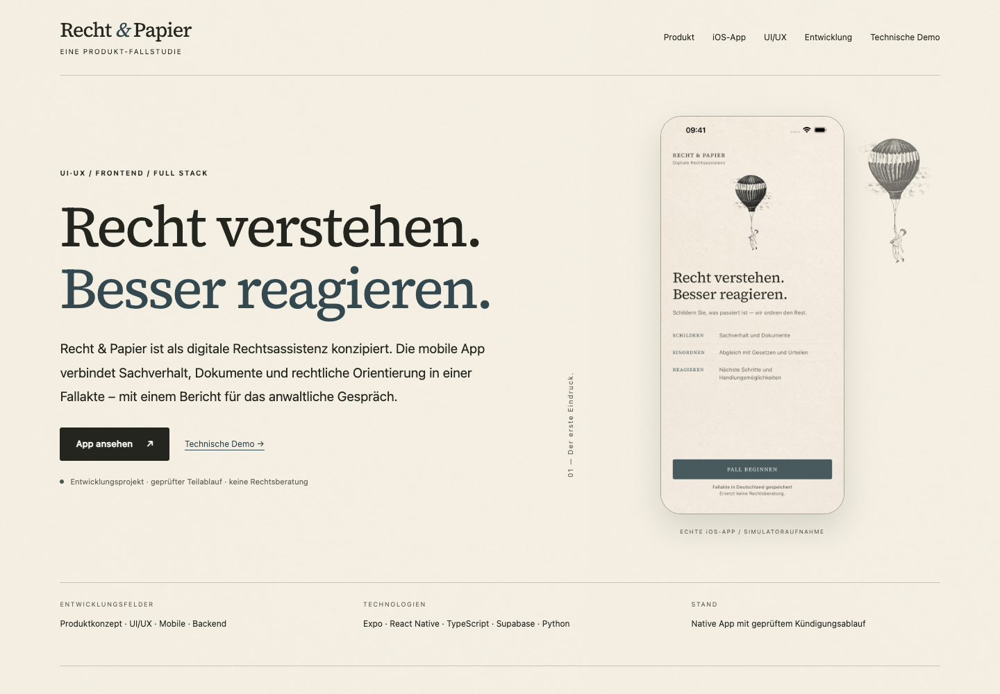

# Recht & Papier

**[Produkt-Fallstudie öffnen](https://recht-papier-portfolio.vercel.app)** · **[Beispielbericht als PDF](apps/mobile/public/portfolio/dev-01-report.pdf)** · **[Nativer iPhone-Ablauf in Screenshots](docs/portfolio/native/README.md)**

Recht & Papier ist als **digitale Rechtsassistenz** konzipiert: eine mobile App, die Sachverhalt, Dokumente, rechtliche Orientierung und nächste Schritte in einer Fallakte verbindet. Die Fallstudie zeigt die echte iOS-Oberfläche, UI/UX-Entscheidungen, Full-Stack-Implementierung und den tatsächlichen Entwicklungsstand. Der aktuell kontrolliert geprüfte Teil ist die **ordentliche Arbeitgeberkündigung aus Arbeitnehmersicht**; die umfassendere Assistenz bleibt eine Produktvision.

In zwei Minuten: Produkt und Entwicklungsstand verstehen → den nativen Ablauf ansehen → Gestaltung und technische Beiträge nachvollziehen. Der nachgelagerte Abschnitt **Technische Demo** erhält drei fiktive Fälle mit Bestätigung, Quellen, Rechenweg und Bericht. Er zeigt gespeicherte Ergebnisse der echten gehosteten Pipeline, ohne Anmeldung, persönliche Uploads oder Modellkosten pro Besucher. Keine Rechtsberatung.

<a href="https://recht-papier-portfolio.vercel.app"></a>

## Architektur und eigener technischer Beitrag

Expo SDK 57 / React Native 0.86, TypeScript, Supabase und die bestehende Python-Engine auf Modal bleiben erhalten. [Architektur mit Datenfluss und Grenzen](docs/architecture.md).

- **Verlässliche Berechnungsgrundlage:** typisierte Angaben mit Seite, wörtlichem Zitat und Nutzerbestätigung; bestehender Freitext wird nicht automatisch zur Rechengrundlage.
- **Code statt Datumsübernahme aus Modelltext:** begrenzte Fristregeln, explizite Voraussetzungen und offene Prüfpunkte. Ein passendes Zitat kann eine widersprüchliche Schlussfolgerung nicht freigeben.
- **Ein Schnittstellenvertrag:** versioniertes JSON Schema, generierte TypeScript-Typen und serverseitige Validierung trennen Fakten, Berechnungen, rechtliche Prüfpunkte und Unsicherheiten.
- **Vollständiger Quellenstand:** 16 frisch aufgebaute amtliche Normtexte, unveränderliche Version und Text-Hashes. Der bisherige breitere Live-Index bleibt erhalten; geänderte Texte werden im Indexer unter derselben ID neu eingebettet.
- **Echter privater Backend-Pfad:** private PDFs, Textauslese, eingefrorener Eingabestand, asynchroner Auftrag, authentifizierter Callback und atomare Analyse-/Quellen-/Fristspeicherung. Der kontrollierte Modal-Worker erhält nur öffentliche Versionskennungen.
- **Öffentliche und private Daten getrennt:** ein eigener Web-Einstieg enthält ausschließlich kuratierte Beispiele. Der native Ablauf nutzt weiterhin Supabase Auth und Eigentümer-RLS.

Die Python-Engine liegt im separaten, zugangsbeschränkten Repository [Jura](https://github.com/dreamtelligence/Jura). Dieses Repository enthält den öffentlichen Demo-Pfad und die Supabase-Integration, nicht den gesamten allgemeinen RAG-Dienst.

## Vorher → Regression → Korrektur → Messung

| Ursprünglicher Fehler | Nachweis und Korrektur |
| --- | --- |
| XML-Text ohne Elementnachtexte verloren | Derselbe amtliche § 622 BGB: alter Parser **1.931**, vollständiger Parser **2.308 Zeichen**; Vertragsausnahme und Teilzeitzählung wieder enthalten. [Messung](docs/portfolio/corpus-before-after.json) |
| Bestehende Dokument-ID überspringt geänderten Text | Regression prüft neues Embedding, dieselbe Punkt-ID, Persistenz und Wiederladen; unterbrochene Versionen werden gesperrt. Implementierung und Tests im Jura-Repository. |
| Zitierte Datumszeichenfolge gilt als Berechnung | Der echte alte Extraktor liefert `2026-11-31`; die neue Kalenderprüfung weist das zurück. Für den Referenzfall berechnet der Code `2026-11-30` und blockiert die beobachtete widersprüchliche Modellformulierung. [Reproduktion](docs/portfolio/before-after.json) |
| Quellenprüfung genügt für freie Schlussfolgerungen | Der reale Gemini-Versuch enthält in **15 von 17 auswertbaren Antworten** abweichende Termine. Keine Modellfreigabe; kontrollierte Regeln und offene Fragen bleiben der Produktpfad. [Auswertung und Grenzen](docs/portfolio/evaluation.md) |

Der ungültige Datumsvorschlag ist eine isolierte Reproduktion des alten Extraktors; die alte Datenbank hat ihn damit nicht nachweislich gespeichert. Alte freie Modellantworten und neue kontrollierte Ergebnisse sind unterschiedliche Arbeitslasten, kein vergleichbarer Geschwindigkeitsbenchmark.

## Überprüfbarer Stand

24 fiktive Referenzfälle: 16 Entwicklungsfälle und acht getrennte Abnahmefälle, letztere dreimal ausgeführt. **40 deterministische Ausführungen, keine Referenzabweichung.** Die Erwartungen sind kein unabhängiger anwaltlicher Goldstandard.

[Gehosteter Ende-zu-Ende-Nachweis](docs/portfolio/backend-e2e.json) · [Browserprüfung](docs/portfolio/browser-verification.json) · [Native Sichtprüfung und PDF](docs/portfolio/native/README.md) · [Release-Status](docs/portfolio/release-status.md)

Die drei veröffentlichten Fälle durchlaufen reale PDF-Textauslese, bestätigte Belege, den Modal-Auftrag, Ergebnisfreigabe und Berichtserstellung. Zusätzlich wurden Zugriffstrennung, atomare Speicherung, veraltete Eingabestände und Dokumentfreigabe gegen das konfigurierte Testprojekt geprüft. Die native Sichtprüfung erfolgte im iPhone-Simulator; sie ist keine Prüfung auf einem physischen Gerät.

Der auf Nutzerwunsch ausgeführte Vergleich verwendet das vorhandene Qwen-Modell und Gemini. Qwen hatte keine verfügbare EU-L40S-Kapazität; Gemini erreichte die Quote vor Abschluss der Wiederholungen. Der vollständige Modellvergleich und der endgültige Kostenabgleich sind **nicht abgeschlossen**. Es gibt keine Modellrangliste oder behauptete fachliche Freigabe. Der Tag `v1.0.0` setzt die offenen Abnahmen voraus.

## Lokal reproduzieren

Node.js 24, Python 3 und Deno 2.9 werden für die öffentlichen Checks benötigt:

```sh
npm --prefix apps/mobile ci
npm --prefix apps/mobile run typecheck
npm --prefix apps/mobile run test:analysis-status
python3 scripts/generate-contract.py --check
npm run test:portfolio
npm run eval:portfolio
deno run --allow-read --allow-write --allow-run --config supabase/functions/deno.json scripts/compare-regression.ts
npm run build:demo
python3 scripts/check-public-bundle.py
python3 -m http.server 3291 --bind 127.0.0.1 --directory apps/mobile/dist
```

Der statische Build benötigt keine `.env` und keine Cloud-Zugangsdaten. Die gespeicherten PDFs und Ergebnisse sind eingecheckt. Die Browserprüfung in `scripts/verify-browser.mjs` benötigt Playwright und Chromium; `PLAYWRIGHT_MODULE` und `BROWSER_EXECUTABLE` erlauben vorhandene lokale Installationen. `DEMO_URL` prüft ein anderes Deployment. `RENDER_REPORTS=1` erzeugt bei lokaler Ausführung die Bericht-PDFs erneut. `scripts/verify-mobile-scroll.mjs` prüft echte Touch-Eingabe in Chromium sowie Scrollen in WebKit bei Smartphonebreite; dafür müssen die entsprechenden Playwright-Browser installiert sein. [Präsentation und Scrollregression](docs/portfolio/presentation/README.md).

Für den privaten nativen Pfad ein eigenes Supabase-Testprojekt mit Migrationen, privaten Buckets, Edge Functions und dem separaten Modal-Worker konfigurieren. Zugangsdaten bleiben in ignorierten `.env`-Dateien beziehungsweise Server-Secrets. Dann `npm --prefix apps/mobile run ios`. Die Integrationstests in `supabase/tests/` und `scripts/verify-portfolio-e2e.py` erstellen temporäre Testkonten und benötigen entsprechend autorisierten Backend-Zugang; sie sind keine anonymen CI-Tests.

Der iOS-Simulator-Entwicklungsbuild benötigt einen laufenden Metro-Server. Standard ist Port 8081; separat starten mit `npm --prefix apps/mobile run start -- --localhost`. Bei „No script URL provided“ zuerst Server und gespeicherte Bundler-Adresse prüfen. Eine Adresse, die nur als Startargument übergeben wird, bleibt beim späteren Öffnen über das App-Icon nicht erhalten. `expo run:ios --no-bundler` startet selbst keinen Server. Ein eigenständig startender Release-Build ist davon getrennt.

## Umfang und Grenzen

Unterstützt werden PDFs mit Textebene und ausdrücklich bestätigte gesetzliche Grundfälle. Der gerichtliche Feiertagskalender ist auf **NRW 2026/2027** begrenzt. Unbekannter Zugang, widersprüchliche Angaben, Tarifabweichungen und Sonderfälle bleiben offen. Scans benötigen künftig OCR. Kündigungsgrund, Sozialauswahl und Gesamtwirksamkeit werden nicht abschließend beurteilt.

„Technische Prüfungen bestanden“, Nutzerbestätigung und anwaltliche Prüfung sind verschiedene Aussagen. Eine anwaltliche Prüfung ist nicht bestätigt; eine pauschale Validierungsbehauptung wird nicht verwendet. Impressum und Datenschutz enthalten auf Nutzerwunsch erkennbare Portfolio-Platzhalter. Das ist keine Store-Einreichung oder Freigabe für echte Rechtsberatung.

## Ausblick für echte Fälle

Ein echter Pilot gehört nicht zu diesem Release. Vor einer Nutzung mit realen Fällen wären ein bestätigtes fachliches Leistungsbild und Review, vollständige Anbieter- und Datenschutzangaben, belastbare Aufbewahrungs-/Löschregeln, Vertrags- und Datenflussprüfung, Betriebsüberwachung, Backup-/Wiederherstellungsnachweise sowie die offenen Store-Voraussetzungen zu erfüllen. Ein Anwalt-Prüferportal, Abrechnung, ein allgemeiner Rechtsassistent und weitere Rechtsgebiete werden hier nicht gebaut.
