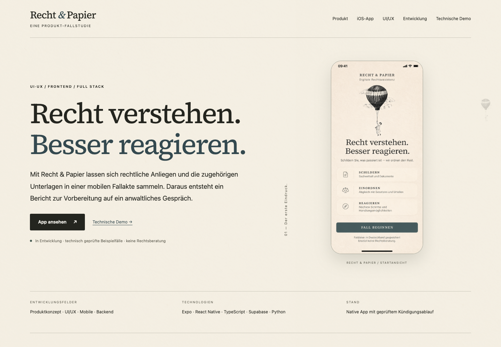

# Recht & Papier

**[Produkt-Fallstudie öffnen](https://recht-papier-portfolio.vercel.app)** · **[Beispielbericht als PDF](apps/mobile/public/portfolio/dev-01-report.pdf)** · **[Nativer iPhone-Ablauf in Screenshots](docs/portfolio/native/README.md)**

Recht & Papier ist eine mobile App für rechtliche Anliegen. Sie sammelt die Schilderung, Dokumente und bestätigte Angaben in einer Fallakte. Daraus entsteht ein Bericht zur Vorbereitung auf ein anwaltliches Gespräch.

Das Projekt umfasst Produktkonzept, UI/UX, die App und das Backend. Ein erster Ablauf ist für die **ordentliche Kündigung durch den Arbeitgeber aus Sicht des Arbeitnehmers** umgesetzt und technisch geprüft. Weitere Fallarten sind geplant. Eine anwaltliche Prüfung steht noch aus.

Die [Website](https://recht-papier-portfolio.vercel.app) zeigt die iOS-App, ihre Gestaltung und die technische Umsetzung. In der **interaktiven Demo** lassen sich drei fiktive Fälle durchgehen: Dokument lesen, Angaben bestätigen, Ergebnis und Bericht ansehen. Die Ergebnisse wurden vorab mit dem gehosteten Backend erstellt. Besucher brauchen weder ein Konto noch eigene Unterlagen; beim Durchklicken startet keine KI-Analyse. Das Projekt bietet keine Rechtsberatung.

<a href="https://recht-papier-portfolio.vercel.app"></a>

## Technische Umsetzung

**Zuletzt geprüft am 16.11.2026:** Bei der [Prüfung aus Verbraucher- und Kanzleisicht](docs/research/2026-11-16-product-and-kanzlei-review.md)
fielen unter anderem widersprüchliche Belege, veraltete Exportfreigaben und
Lücken bei der Dateibereinigung auf. Die Korrekturen sind durch Regressionstests
abgesichert. Auch der allgemeine LEX-Dienst prüft Antworten jetzt zentral vor
der Ausgabe und rendert sie abgesichert.
[Änderungen und Prüfungen](docs/research/2026-11-16-remediation.md).

Anschließend wurde der Kündigungsablauf in einer getrennten Supabase-/Modal-Umgebung
vom Login bis zum Export geprüft: **22 Prüfschritte bestanden**. Dabei fiel auf,
dass ein alter Token nach der Kontolöschung noch Dateien hochladen konnte; auch
dieser Fehler wurde behoben und erneut geprüft. Ein neuer nativer Release-Build
lief im iPhone-Simulator bis zum vierseitigen PDF durch.
[Versuchsaufbau, Ergebnisse und Grenzen](docs/research/2026-11-16-isolated-rollout.md).
Das bisherige Produktivbackend wurde dabei nicht aktualisiert. Eine Prüfmappe
für Kanzleien ist noch geplant.

Für den Einstieg in den Code: [Dokumentationsindex](docs/README.md), [Schnittstellenvertrag](packages/shared/contract.schema.json), [kontrollierte Berechnung](packages/shared/termination.ts) und [Berichtserstellung](packages/shared/report.ts). Ältere Architektur- und Agentenaufzeichnungen sind dort ausdrücklich als historisch eingeordnet.

Die App verwendet Expo SDK 57 / React Native 0.86 und TypeScript. Das Backend besteht aus Supabase und einer Python-Engine auf Modal. [Architektur mit Datenfluss und Grenzen](docs/architecture.md).

- **Angaben mit Belegen:** Jeder Wert verweist auf eine Seite und ein wörtliches Zitat und muss bestätigt werden. Zitat und Seite müssen denselben beschrifteten Feldwert enthalten. Freie Prosa und eigene Erinnerungen gelten nicht als Dokumentbeweis. Nur der Server speichert extrahierte Texte; ältere zwischengespeicherte Texte müssen nach der Migration neu eingelesen werden.
- **Fristberechnung:** Feste Regeln berechnen Termine aus bestätigten Angaben. Voraussetzungen und offene Fragen stehen beim Ergebnis. Widersprüchliche Modellantworten bleiben auch dann gesperrt, wenn sie ein passendes Zitat enthalten.
- **Gemeinsames Ergebnisformat:** Ein versioniertes JSON Schema und daraus generierte TypeScript-Typen beschreiben Fakten, Berechnungen, rechtliche Prüfpunkte und Unsicherheiten. Der Server validiert die Ergebnisse gegen diesen Vertrag.
- **Versionierte Quellen:** Der Kündigungsablauf verwendet 16 amtliche Normtexte mit festen Versionen und Text-Hashes. Die allgemeine Rechtssuche läuft getrennt davon und verwendet seit dem 11.11.2026 einen geprüften Index aus Textabschnitten.
- **Verarbeitung im Hintergrund:** Der Server liest private PDFs und hält den Eingabestand für den Analyseauftrag fest. Die Rückmeldung des Workers wird authentifiziert; Analyse, Quellen und Fristen werden gemeinsam gespeichert. Der kontrollierte Modal-Worker erhält nur öffentliche Versionskennungen.
- **Zugriffsschutz:** Die öffentliche Website enthält nur fiktive Beispiele. In der nativen App sichern Supabase Auth und Eigentümer-RLS den Zugriff auf private Fallakten.

Die Python-Engine liegt im separaten, zugangsbeschränkten Repository [Jura](https://github.com/dreamtelligence/Jura). Dieses Repository enthält den öffentlichen Demo-Pfad und die Supabase-Integration, nicht den gesamten allgemeinen RAG-Dienst.

## Fehler und ihre Korrekturen

| Ursprünglicher Fehler | Nachweis und Korrektur |
| --- | --- |
| Beim XML-Einlesen gehen Texte nach Unterelementen verloren | Derselbe amtliche § 622 BGB: alter Parser **1.931**, vollständiger Parser **2.308 Zeichen**; Vertragsausnahme und Teilzeitzählung wieder enthalten. [Messung](docs/portfolio/corpus-before-after.json) |
| Bestehende Dokument-ID überspringt geänderten Text | Regression prüft neues Embedding, dieselbe Punkt-ID, Persistenz und Wiederladen; unterbrochene Versionen werden gesperrt. Implementierung und Tests im Jura-Repository. |
| Ein Datum aus dem Modelltext wird ungeprüft übernommen | Der echte alte Extraktor liefert `2026-11-31`; die neue Kalenderprüfung weist das zurück. Für den Referenzfall berechnet der Code `2026-11-30` und blockiert die beobachtete widersprüchliche Modellformulierung. [Reproduktion](docs/portfolio/before-after.json) |
| Eine Quellenprüfung erkennt falsche Schlussfolgerungen nicht | Der reale Gemini-Versuch enthält in **15 von 17 auswertbaren Antworten** abweichende Termine. Deshalb bleiben freie Modellantworten gesperrt; der Kündigungsablauf verwendet feste Regeln. [Auswertung und Grenzen](docs/portfolio/evaluation.md) |

Der ungültige Datumsvorschlag ist eine isolierte Reproduktion des alten Extraktors; die alte Datenbank hat ihn damit nicht nachweislich gespeichert. Alte freie Modellantworten und neue kontrollierte Ergebnisse sind unterschiedliche Arbeitslasten, kein vergleichbarer Geschwindigkeitsbenchmark.

## Tests und Nachweise

Die dokumentierte Referenzauswertung umfasst 24 fiktive Fälle: 16 Entwicklungsfälle und acht separate Abnahmefälle. Die Abnahmefälle wurden jeweils dreimal ausgeführt. **Alle 40 Testläufe entsprachen den hinterlegten Erwartungen.** Diese Erwartungen wurden nicht unabhängig anwaltlich geprüft.

[Gehosteter Ende-zu-Ende-Nachweis](docs/portfolio/backend-e2e.json) · [Browserprüfung](docs/portfolio/browser-verification.json) · [Native Sichtprüfung und PDF](docs/portfolio/native/README.md) · [Release-Status](docs/portfolio/release-status.md)

Die drei veröffentlichten Fälle wurden vorab durch reale PDF-Textauslese, bestätigte Belege, den Modal-Auftrag, Ergebnisfreigabe und Berichtserstellung erzeugt. Zusätzlich wurden Zugriffstrennung, atomare Speicherung, veraltete Eingabestände und Dokumentfreigabe gegen das konfigurierte Testprojekt geprüft. Die native Sichtprüfung erfolgte im iPhone-Simulator; sie ist keine Prüfung auf einem physischen Gerät.

Für den Modellvergleich wurden Qwen und Gemini verwendet. Qwen hatte keine verfügbare EU-L40S-Kapazität; Gemini erreichte die Quote vor Abschluss der Wiederholungen. Der vollständige Modellvergleich und der endgültige Kostenabgleich sind **nicht abgeschlossen**. Aus diesem Versuch lässt sich weder eine belastbare Rangliste noch eine fachliche Freigabe ableiten. Der Tag `v1.0.0` setzt die offenen Abnahmen voraus.

## Allgemeine Rechtssuche: Messung vom 11.11.2026

Der getrennte Suchdienst `legal-rag` **v41** enthält **17.132 Indexeinträge aus
17.060 vollständigen Quellen**; der Analyse-Worker **v5** enthält den Guard gegen
die beobachtete KSchG-Bedeutungsumkehr. Alle **21 Live-Suchverträge** bestehen.
In einer kleinen sequenziellen Messreihe nach dem Kaltstart lag der Median bei
**2,004 Sekunden**. Ein Profilfall enthält zusätzlich den kontrollierten
Suchaufruf. Die Messung sagt noch nichts über das Verhalten unter Last oder
die juristische Qualität der Antworten aus.

[Live-Nachweis mit Hashes und geprüftem Datenrückweg](docs/portfolio/live-index-release-2026-11-11.json) ·
[Textfenster und Latenzvergleich](docs/portfolio/candidate-hardening-2026-11-11.json) ·
[Antwort-Vorprüfung](docs/portfolio/answer-review-2026-11-11.md)

Der kontrollierte Portfolio-Korpus bleibt unverändert bei 16 Normtexten; die
öffentliche Fallstudie startet weiterhin keine Modelle. Der zum Live-Snapshot passende
[Jura-Runtime-Quellstand](https://github.com/dreamtelligence/Jura/blob/main/docs/runtime-source-publication.md)
ist jetzt auf GitHub veröffentlicht und anhand aller 38 archivierten Dateien
abgeglichen. Das gemeinsame serverseitige
[Antwort-Gate für den allgemeinen LEX-Pfad](https://github.com/dreamtelligence/Jura/blob/main/docs/next-step-answer-release.md)
ist inzwischen isoliert installiert: 21/21 HTTP-Suchverträge sowie tatsächliche
JSON-/SSE-Ausfallpfade ohne Textmodell-Zugangsdaten sind geprüft.
[Neuer Nachweis und Grenzen](docs/research/2026-11-16-isolated-rollout.md).
Freie juristische Modellantworten und der Produktionswechsel sind damit nicht freigegeben.

## Wiederherstellung der Python-Engine

Der Jura-Kern wurde aus einem frischen GitHub-Klon und dem unabhängig
heruntergeladenen Index-Backup in einem neuen Volume mit neuem Modell-Image und
Testschlüsseln aufgebaut. **17.132 Punkte geprüft, 21/21 HTTP-Suchverträge und
kontrollierter Worker-Probe bestanden; Testressourcen anschließend entfernt.**
Der Lauf benötigte 8 Minuten 19 Sekunden ab Skriptstart, ohne vorausgehendes
Klonen und Herunterladen; dies ist kein SLA. Die drei produktiven Secret-Gruppen
sind zusätzlich verschlüsselt außerhalb von Modal gesichert und aus der neu
heruntergeladenen Datei wiederhergestellt worden. Die Originalwerte blieben
unverändert. [Nachweis und Grenzen](docs/portfolio/recovery-drill-2026-11-11.json) ·
[Anleitung im privaten Jura-Repository](https://github.com/dreamtelligence/Jura/blob/main/docs/recovery.md).

Der Entschlüsselungsschlüssel liegt im lokalen macOS-Schlüsselbund; eine weitere
Offline-Kopie ist noch offen. Supabase-Datenbank, Auth, private Dateien und echte
Fallaufträge wurden bei diesem Jura-Test nicht wiederhergestellt. Die aktuelle
schnelle Python-Suite besteht 290 Tests.

## Lokal reproduzieren

Node.js 24, Python 3 und Deno 2.9 werden für die öffentlichen Checks benötigt:

```sh
npm --prefix apps/mobile ci
npm --prefix apps/mobile run typecheck
npm --prefix apps/mobile run test:analysis-status
npm --prefix apps/mobile run test:casefile-boundaries
node scripts/test-document-extraction.cjs
python3 scripts/generate-contract.py --check
npm run test:portfolio
npm run test:database
npm run eval:portfolio
deno run --allow-read --allow-write --allow-run --config supabase/functions/deno.json scripts/compare-regression.ts
npm run build:demo
python3 scripts/check-public-bundle.py
python3 -m http.server 3291 --bind 127.0.0.1 --directory apps/mobile/dist
```

Der statische Build benötigt keine `.env` und keine Cloud-Zugangsdaten. Die gespeicherten PDFs und Ergebnisse sind eingecheckt. Die Browserprüfung in `scripts/verify-browser.mjs` benötigt Playwright und Chromium; `PLAYWRIGHT_MODULE` und `BROWSER_EXECUTABLE` erlauben vorhandene lokale Installationen. `DEMO_URL` prüft ein anderes Deployment. `RENDER_REPORTS=1` erzeugt bei lokaler Ausführung die Bericht-PDFs erneut. `scripts/verify-mobile-scroll.mjs` prüft echte Touch-Eingabe in Chromium sowie Scrollen in WebKit bei Smartphonebreite; dafür müssen die entsprechenden Playwright-Browser installiert sein. [Präsentation und Scrollregression](docs/portfolio/presentation/README.md).

Für den privaten nativen Pfad ein eigenes Supabase-Testprojekt mit Migrationen, privaten Buckets, Edge Functions und dem separaten Modal-Worker konfigurieren. Zugangsdaten bleiben in ignorierten `.env`-Dateien beziehungsweise Server-Secrets. Dann `npm --prefix apps/mobile run ios`. Die Integrationstests in `supabase/tests/` und `scripts/verify-portfolio-e2e.py` erstellen temporäre Testkonten und benötigen entsprechend autorisierten Backend-Zugang; sie sind keine anonymen CI-Tests.

Der iOS-Simulator-Entwicklungsbuild benötigt einen laufenden Metro-Server. Standard ist Port 8081; separat starten mit `npm --prefix apps/mobile run start -- --localhost`. Bei „No script URL provided“ zuerst Server und gespeicherte Bundler-Adresse prüfen. Eine Adresse, die nur als Startargument übergeben wird, bleibt beim späteren Öffnen über das App-Icon nicht erhalten. `expo run:ios --no-bundler` startet selbst keinen Server. Ein eigenständig startender Release-Build ist davon getrennt.

## Umfang und Grenzen

Unterstützt werden PDFs mit Textebene und ausdrücklich bestätigte gesetzliche Grundfälle. Der gerichtliche Feiertagskalender ist auf **NRW 2026/2027** begrenzt. Unbekannter Zugang, widersprüchliche Angaben, Tarifabweichungen und Sonderfälle bleiben offen. Scans benötigen künftig OCR. Kündigungsgrund, Sozialauswahl und Gesamtwirksamkeit werden nicht abschließend beurteilt.

Die technischen Tests und die Bestätigung durch den Nutzer ersetzen keine anwaltliche Prüfung. Diese steht noch aus. Impressum und Datenschutz enthalten erkennbare Portfolio-Platzhalter. Das Projekt ist weder für den App Store eingereicht noch für echte Rechtsberatung freigegeben.

## Ausblick für echte Fälle

Dieses Release dient als Portfolio. Vor einem Pilotbetrieb mit realen Fällen müssen der fachliche Umfang und die Ergebnisse juristisch geprüft werden. Außerdem fehlen vollständige Anbieter- und Datenschutzangaben, geprüfte Verträge und Datenflüsse, verbindliche Aufbewahrungs- und Löschregeln sowie Nachweise für Betriebsüberwachung und Wiederherstellung. Auch die offenen Store-Voraussetzungen bleiben zu erfüllen. Ein Kanzleiportal, Abrechnung und weitere Rechtsgebiete gehören nicht zu diesem Release.
