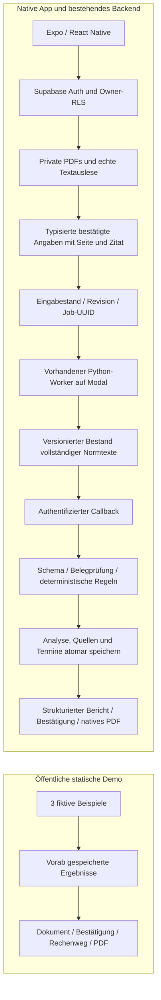

# Architektur und überprüfbare Beiträge

Die Produktvision von Recht & Papier ist eine umfassendere digitale Rechtsassistenz. Die native App enthält bereits Konto, Fallakten, private Dokumente, Rechtssuche und Berichte. Die öffentliche Produkt-Fallstudie zeigt diese Oberflächen und unterscheidet implementierte Grundlagen, Teilumsetzungen und geplante Funktionen.

Der folgende technische Nachweis beschreibt den kontrolliert geprüften Teil: eine **fiktive ordentliche Arbeitgeberkündigung aus Arbeitnehmersicht**, aufbereitet für ein anwaltliches Gespräch. Der freigegebene Portfolio-Pfad erzeugt kontrollierte Prüfpunkte und offene Fragen. Er entscheidet nicht über die Wirksamkeit einer Kündigung.

## Zwei Wege mit demselben Ergebnisvertrag



Der öffentliche Web-Einstieg importiert weder die private Router-Gruppe noch Supabase. Die gespeicherten Beispiele sind ausschließlich fiktiv und wurden durch den echten Backend-Pfad erzeugt. Ein Besucher startet keinen Modellaufruf. `localStorage` hält nur Fallauswahl, Schritt und Demo-Bestätigungen. Eine Änderung dieses Fortschritts verändert keine gespeicherte Analyse.

Die native App behält den vorhandenen asynchronen Analysepfad: Start mit HTTP 202, privater eingefrorener Eingabestand, genau eine Worker-Übernahme, Lease, Polling und authentifizierter Ergebniscallback. Der kontrollierte Python-Pfad erhält **nur öffentliche Versionskennungen**, keine privaten Dokumente oder Fallangaben. Berechnung und Belegprüfung laufen an der bestehenden Supabase-Grenze aus dem eingefrorenen Original. Bestehende andere Engine-Pfade sind davon getrennt; diese Darstellung ist keine Zusage für deren Datenresidenz.

## Schnittstellenvertrag und Bestätigung

`packages/shared/contract.schema.json` ist die gemeinsame Quelle. `scripts/generate-contract.py` erzeugt die TypeScript-Typen; ein Drift-Check prüft sie. Die Edge Functions validieren Ein- und Ausgabe gegen dasselbe JSON Schema mit fest gepinnter Ajv-Version.

Ein Berechnungsfakt trägt Schlüssel, Wert, Bestätigung und Dokument-ID, Seite sowie wörtliches Zitat. Nur bestätigte, vorhandene Belegstellen werden berücksichtigt. Die Bestätigung ist eine Nutzeraussage, kein Echtheitsnachweis und keine fachliche Prüfung. Die kuratierten PDFs verwenden eindeutige Feldbezeichnungen. Andere Dokumentformulierungen erfordern manuelle Zuordnung; eine allgemeine semantische Dokumentextraktion wird nicht behauptet.

Bestehende Freitextangaben bleiben erhalten und werden nicht automatisch als Berechnungsgrundlage übernommen. Änderungen an strukturierten Angaben erhöhen `input_revision`; ein alter oder zwischenzeitlich veränderter Lauf darf keine aktuelle Analyse oder freigebbare Datei erzeugen.

## Unterstützte Regeln und Grenzen

- Gesetzlicher Vergleichstermin nach § 622 Abs. 1/2 BGB, §§ 187/188 BGB: vier Wochen zum 15./Monatsende oder die ausdrücklich unterstützten Beschäftigungsstaffeln zum Monatsende. Keine Verschiebung des Kündigungstermins wegen eines Wochenendes.
- Klagefrist im bestätigten Grundfall nach § 4 KSchG mit §§ 187/188 BGB, § 222 ZPO und § 46 ArbGG. Feiertagskalender ausschließlich für ein zuständiges Arbeitsgericht in **NRW, 2026/2027**.
- Unbekannter Zugang, widersprüchliche bestätigte Werte oder unplausible Chronologie tragen keine sichere Berechnung. Unbekannte Vertrags-/Tarifregeln, Probezeit und Sonderkündigungsschutz sperren die jeweils davon abhängige Regel.
- Keine automatische Aussage zu Kündigungsgrund, Sozialauswahl, Anwendbarkeit des allgemeinen Kündigungsschutzes, einer behördlichen Genehmigung oder der Wirksamkeit der Kündigung insgesamt.
- § 174 BGB bleibt ein offener Prüfpunkt mit Voraussetzungen und Ausnahme. Keine erfundene feste Tagesfrist für „unverzüglich“.
- Fehlende Unterlagen zur Betriebsratsanhörung sind kein Beweis einer unterlassenen Anhörung. Der Bericht unterscheidet das ausdrücklich.
- PDFs mit Textebene werden gelesen; Bilder, Word-Dateien und Scans werden verständlich abgegrenzt. OCR ist Ausblick.

## Quellenbestand ohne riskanten Austausch des Live-Index

Der Portfolio-Pfad verwendet einen frisch aus amtlichen Quellen aufgebauten, unveränderlichen **Index von 16 vollständigen Normtexten** mit IDs, Abrufdatum, Text-Hashes und XML-Manifest. Für den engen Fall genügt exakter Normzugriff; ein frei suchender Vektorindex ist hier nicht nötig. Abrufdatum und materieller Geltungszeitpunkt werden nicht gleichgesetzt.

Der vorhandene breitere Live-Vektorindex wird nicht überschrieben. Der inkrementelle Indexer im separaten Jura-Repository bettet geänderte Texte nun unter derselben Punkt-ID neu ein und speichert den passenden Katalog. Vollaufbauten verlangen einen frischen lokalen Bestand; Schreibzugriffe auf die bedienende Server-Collection werden verweigert. Ein unterbrochener Schreibvorgang sperrt das Laden dieser Version, statt gemischte Vektoren und Metadaten auszuliefern. Ein vollständiger breiter Neuaufbau samt Embedding-Benchmark bleibt außerhalb dieses begrenzten Releases.

## Warum freie Modelltexte gesperrt bleiben

Der alte Ansatz behandelte eine korrekt zitierte Antwort als hinreichende Grundlage, um Datumsangaben aus Freitext zu übernehmen. Das prüft weder eine Berechnung noch die Schlussfolgerung.

Die neue Datenbankfreigabe verlangt den kontrollierten Modellkennzeichner, den versionierten strukturierten Vertrag und bestandene technische Prüfungen. Quellen und Fristen werden aus dem neu berechneten Ergebnis gespeichert. Eine freie Qwen-/Gemini-Antwort kann diese Freigabe nicht erhalten, selbst wenn alle Zitate formal vorhanden sind. Der zusätzliche Freitext-Widerspruchsdetektor ist nur eine Regression für beobachtete Formulierungen, kein vollständiger semantischer Gutachter.

Der Nutzer ersetzte am 10.11.2026 den geplanten Mistral-Vergleich ausdrücklich durch die bereits vorhandenen Modal-Zugänge: **Qwen/Qwen3.8-27B-FP8 und gemini-2.5-flash-lite**. Es gibt keinen stillen Anbieterwechsel im Produktpfad. Methodik, reale Antworten, Betriebsfehler und Kosten stehen im [Evaluationsnachweis](https://github.com/dreamtelligence/Recht-Papier/blob/main/docs/portfolio/evaluation.md). Der Versuch ist wegen Kapazität und Quote unvollständig; keine der freien Modellvarianten erhielt eine Freigabe.

## Belegter Vorher-/Nachher-Nachweis

| Ursprünglicher Denkfehler | Reproduktion | Korrektur und Nachweis |
| --- | --- | --- |
| XML-Elementtext genügt | Alter Parser auf derselben amtlichen BGB-XML: § 622 hat 1.931 Zeichen | `itertext` erhält Listen und Nachtexte: 2.308 Zeichen, inklusive Vertragsausnahme und Teilzeitzählung; `corpus-before-after.json` |
| Ein existierender Normschlüssel braucht kein neues Embedding | Geänderter Text wird unter unveränderter ID geliefert | Regression prüft neues Embedding, dieselbe Punkt-ID, Persistenz, Wiederladen und unveränderte Duplikate |
| Zitat plus Datumszeichenfolge genügt | Der tatsächliche alte Extraktor liefert den ungültigen Vorschlag `2026-11-31` | Kalender- und Belegprüfung plus Code-Berechnung. Das ist eine isolierte Extraktor-Reproduktion; keine Behauptung, die alte Datenbank habe diesen ungültigen Tag gespeichert |
| „Drei Monate“ und „fristgerecht zum nächsten Monat“ können mit Zitaten bestehen | Beobachteter Kündigungstermin 30.09.2026 bei Zugang 31.08.2026 und neun Beschäftigungsjahren | Gerechneter gesetzlicher Vergleichstermin 30.11.2026; bekannte widersprüchliche Formulierung erkannt; freie Schlussfolgerung unabhängig davon gesperrt |

Die alte lange Modellantwort und der neue kontrollierte Kurzpfad sind unterschiedliche Arbeitslasten. Ihre Laufzeiten werden deshalb nicht als gleichartiger Geschwindigkeitsbenchmark verglichen.

## Reproduzierbare Prüfung

Ohne Produktionszugang im Recht-Papier-Repository:

```sh
npm --prefix apps/mobile ci
npm --prefix apps/mobile run typecheck
npm --prefix apps/mobile run test:analysis-status
python3 scripts/generate-contract.py --check
deno test --allow-read --config supabase/functions/deno.json supabase/tests/case_analysis_test.ts supabase/tests/portfolio_test.ts
deno run --allow-read --allow-write --config supabase/functions/deno.json scripts/evaluate-portfolio.ts
deno run --allow-read --allow-write --allow-run --config supabase/functions/deno.json scripts/compare-regression.ts
cd apps/mobile
EXPO_NO_DOTENV=1 npx expo export --platform web --output-dir dist
```

Die 24 Referenzfälle sind in 16 Entwicklungsfälle und acht getrennte Abnahmefälle aufgeteilt. Die Abnahmefälle werden dreimal gegen unveränderte Rechenregeln ausgeführt. Das ergibt 40 deterministische Ausführungen ohne Modellkosten. Es ist kein unabhängiger anwaltlicher Goldstandard.

Im separaten Jura-Checkout:

```sh
python -m pytest tests/test_portfolio.py tests/test_incremental_updates.py tests/test_statute_xml_completeness.py tests/test_case_jobs.py -q
python scripts/build_portfolio_corpus.py /tmp/neue-unveraenderliche-quellenversion
python scripts/compare_portfolio_corpus.py /tmp/quellenvergleich.json
```

Der echte Backend-Test `python3 scripts/verify-portfolio-e2e.py` benutzt die bestehende lokale Supabase-CLI-Anmeldung, legt ausschließlich einen temporären fiktiven Nutzer an und räumt dessen Dokumente, Fälle und Konto wieder auf. Er benötigt ein eigens dafür freigegebenes Projekt mit deployten Functions und Worker; er ist kein CI-Test gegen fremde Produktionsdaten. SQL-Regressionen verwenden Transaktionen mit Rollback.

Die Modellmessung liegt in Juras `modal_portfolio_eval.py`. Beide Modelle erhalten bytegleiche Eingaben und Quellen; erwartete Antworten stehen nie im Prompt. Acht Abnahmefälle sind je dreimal vorgesehen. Transport-/Kapazitätsfehler, ungültiges JSON, falsche Daten, unbekannte Quellen und fachlich noch zu prüfende Aussagen werden getrennt erfasst. Eine Modellantwort mit Fehlern wird nicht durch einen günstigeren Preis freigegeben.

## Betrieb und Rückweg

Die Migration ist additiv. Eigentümer-RLS und serverseitige Schreibrechte der Ergebnisse bleiben erhalten. Der bisherige breitere Quellenindex und Qwen-Dienst wurden nicht mit einem älteren RAG-Stand überschrieben. Bei einer Störung zuerst neue Portfolio-Starts unterbinden, laufende Leases auslaufen lassen und Worker/Callback gemeinsam auf die bekannte Version bringen. Den neuen Freigabeguard nicht für alte freie Antworten lockern. Bestehende Akten und Originaldokumente werden dabei nicht gelöscht.

Impressum und Datenschutz enthalten auf Nutzerwunsch noch sichtbare Portfolio-Platzhalter. Fachanwaltlicher Review, dessen Umfang, Fachgebiet und Benennung sind nicht bestätigt. Eine Pilotierung ist kein Release-Arbeitspaket. Das Projekt ist keine Freigabe für echte Rechtsberatung oder eine Store-Einreichung.
