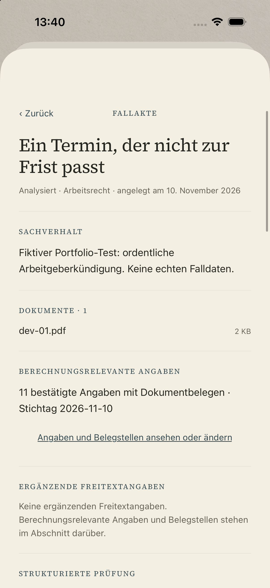
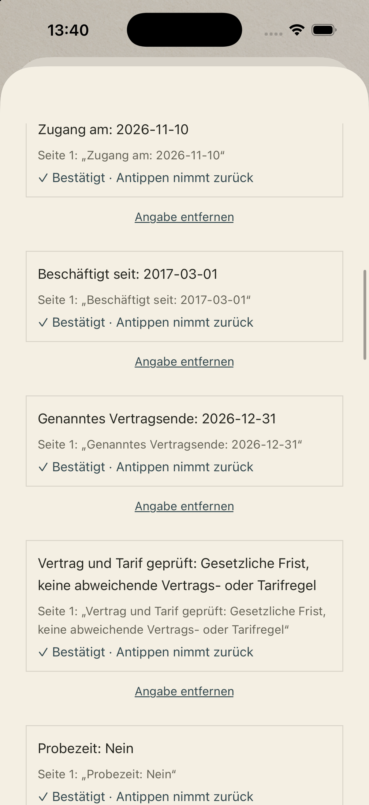
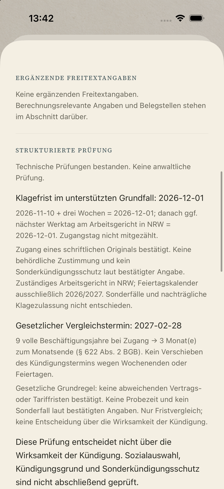
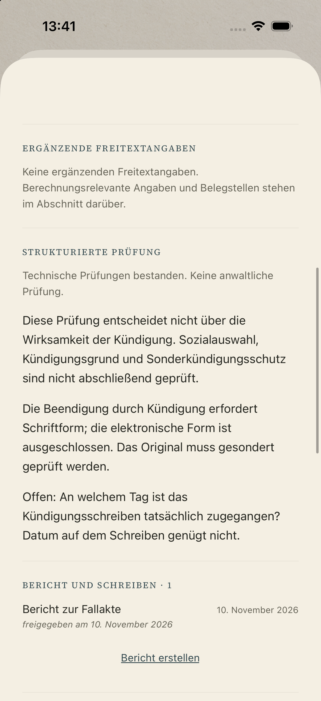
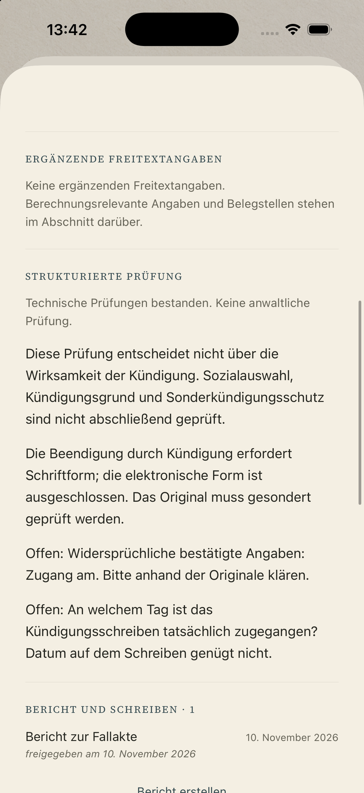
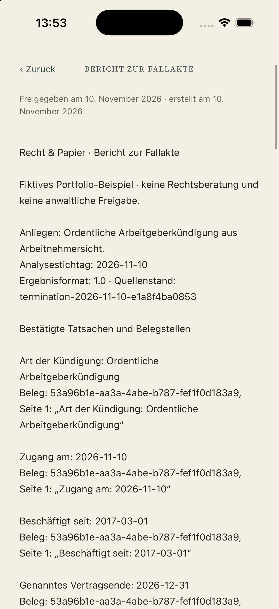
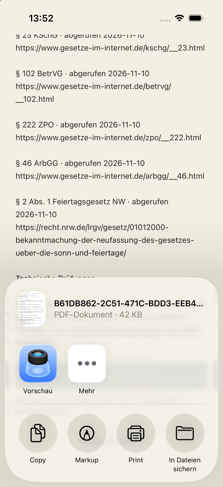

# Native Sichtprüfung

Am 10.11.2026 im nativen Development-Build auf dem **iPhone 17 Pro Simulator, iOS 26.5** geprüft. Der Build lief ohne Fehler oder Warnungen. Die Bilder zeigen ausschließlich fiktive Fälle aus dem echten Supabase-/Modal-Pfad.

| Fallakte | Bestätigte Angaben mit Belegstellen |
| --- | --- |
|  |  |
| **Berechnungen mit Voraussetzungen** | **Fehlender Zugangstag** |
|  |  |
| **Widersprüchliche Angaben** | **Bestätigter Bericht** |
|  |  |
| **Natives PDF und Teilen-Dialog** | |
|  | |

Zusätzliche aktuelle Aufnahme `08-fallaufnahme.png`: unveränderte native Eingabemaske mit dem tatsächlich unterstützten PDF-Format, am 10.11.2026 neu aufgenommen. Keine neue Akte angelegt, keine Daten gespeichert. Die öffentliche Fallstudie verwendet sie statt der älteren Intake-Aufnahme mit inzwischen überholten Dateityp-Hinweisen. Der ursprüngliche Startbildschirm bleibt die echte Aufnahme aus `docs/screenshots/01-start.png`.

[Tatsächlich nativ exportierte PDF](native-export.pdf). Vier Seiten, beide erwarteten Termine und Quellen durch Textauslese überprüft; zusätzlich visuell geprüft. Die Dokumentkennungen gehören zum inzwischen gelöschten synthetischen Testkonto.

Der automatisierte Backend-Test hat die Original-PDFs hochgeladen, mit der echten Textauslese verarbeitet und die drei Analysen samt Berichten erzeugt. Anschließend wurden im nativen Client die gespeicherten Fälle, aufklappbaren Belegstellen, Rechenwege, fehlenden/widersprüchlichen Angaben und die Berichtsvorschau angesehen. Der PDF-Knopf wurde im nativen Client betätigt; `expo-print` erzeugte eine Datei und `expo-sharing` öffnete den iOS-Dialog. Es wurde nichts an Dritte versendet.

Das temporäre Screenshot-Konto, seine Akten und privaten Uploads wurden entfernt; die vorherige App-Anmeldung wurde wiederhergestellt. Ein physisches iPhone, Android, Mail-Code-Anmeldung und ein vollständig manuell neu angelegter Upload wurden in dieser Sichtprüfung nicht erneut getestet. Die frühere native Aufnahme des Intake-Schritts ist unter [docs/screenshots](../../screenshots/README.md) historisch dokumentiert.
