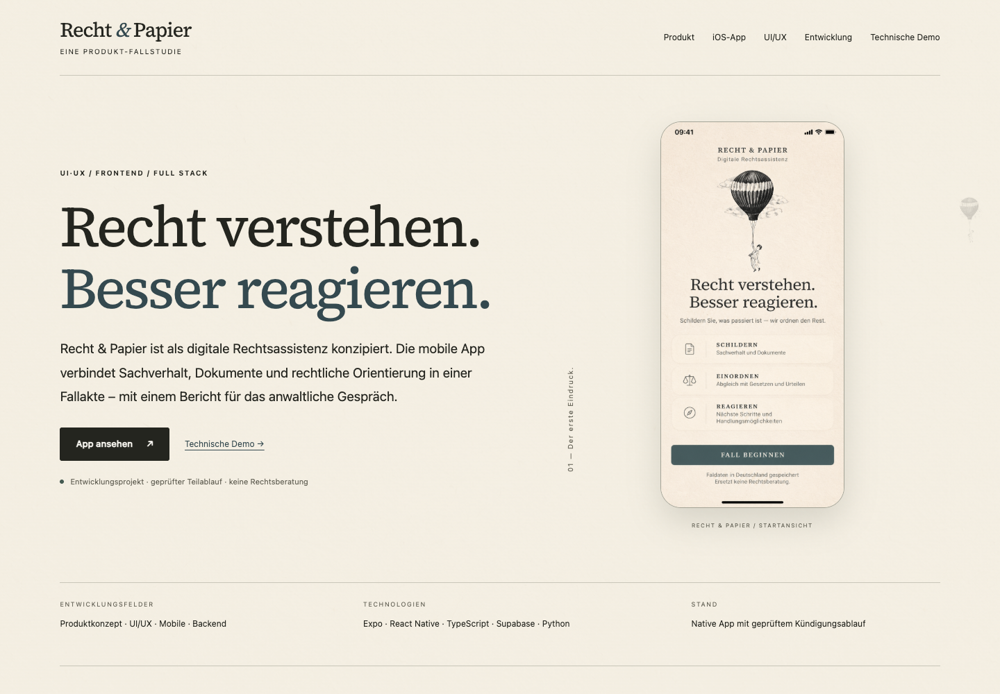
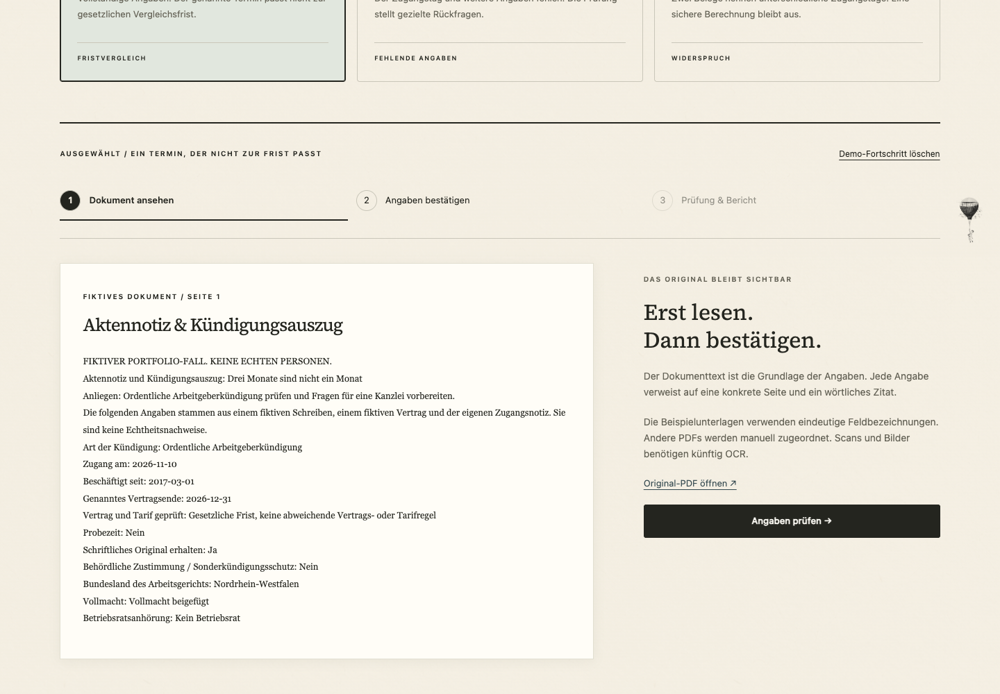
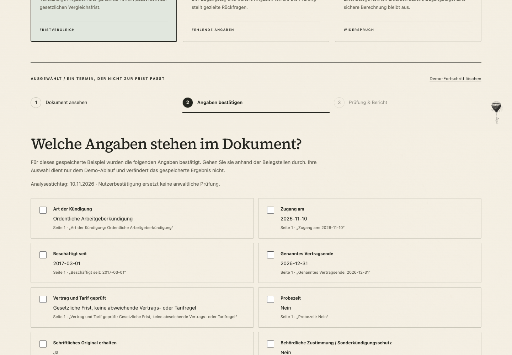
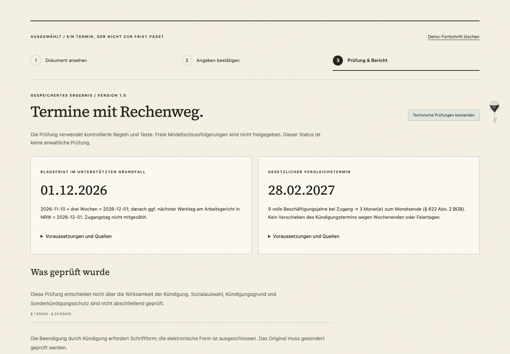
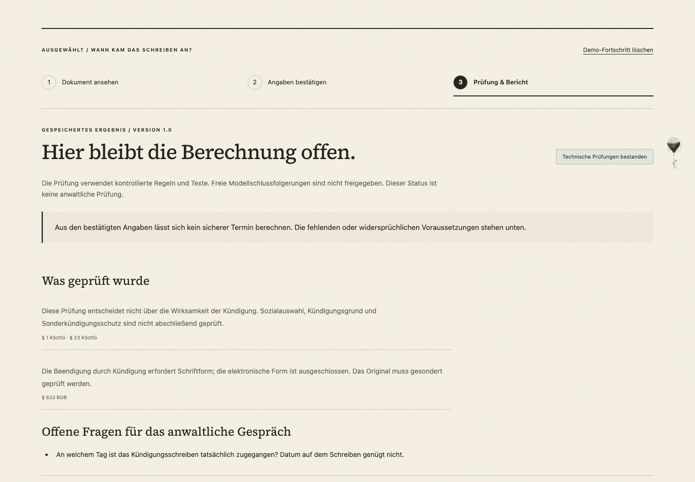
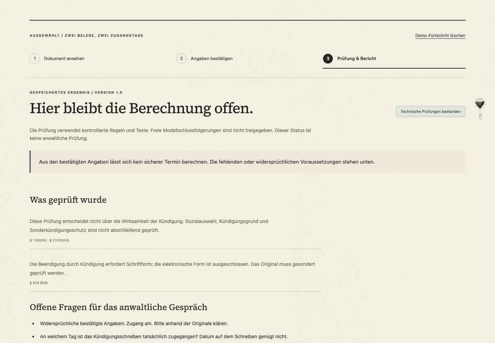

# Verbraucherablauf, Bericht und Übergabe: Sichtprüfung vom 16.11.2026

> Historischer Ausgangsaudit vor der anschließenden Fehlerbehebung. Befunde, Quellstände und ursprüngliche Ausgaben unten beziehen sich auf diesen Vorher-Zustand. Aktuelle Korrekturen, Prüfungen und verbleibende Grenzen stehen im [Korrekturbericht](2026-11-16-remediation.md). Neue Runtime-Korrekturen sind noch nicht gehostet installiert.

## Prüfgegenstand und Methode

Aktuell bediente Oberfläche: https://recht-papier-portfolio.vercel.app/ .
Dies ist ausdrücklich eine öffentliche Produkt-Fallstudie mit gespeicherten,
fiktiven Fällen. Sie ist weder ein öffentliches Mandantenportal noch ein neuer
Nachweis des privaten nativen Backend-Pfads. Die Unterscheidung ist auf der
Seite erkennbar und bleibt bei der Bewertung erhalten.

Die drei Beispiele `dev-01`, `dev-11`, `dev-14` wurden in diesem Lauf über
die tatsächliche Oberfläche bis zum Ergebnis durchgegangen. Der Browser-Host
für die In-App-Oberfläche war nicht verfügbar; deshalb wurde der vorhandene
Brave über Computer Use verwendet. Sechs aktuelle Bildschirmaufnahmen wurden
gespeichert und jeweils nach dem Speichern geöffnet. Diese ursprünglichen
Fensteraufnahmen bleiben lokal, weil sie persönliche Browserleisten enthalten.
Für die Veröffentlichung wurden dieselben öffentlichen Zustände anschließend
in einem isolierten Brave-Profil neu aufgenommen (Viewport 1440 × 1000, reduzierte
Bewegung); die unten eingebundenen Bilder sind diese neuen, unveränderten
Viewportaufnahmen. Es wurden keine Bildinhalte retuschiert.
Der vorgefundene Demo-Fortschritt (erster Fall, Schritt 2,
keine Bestätigungen) wurde anschließend wiederhergestellt.

Zusätzlich wurden die sechs öffentlich verlinkten PDFs neu abgerufen:
je ein Original und ein Bericht für jeden Fall. Alle antworteten mit HTTP 200,
hatten eine PDF-Signatur und waren bytegleich zu den lokalen öffentlichen
Artefakten. Jeder Bericht hat drei Seiten. Alle neun Berichtsseiten wurden
mit Poppler gerendert und vollständig visuell angesehen; daneben wurde der
extrahierte Text gelesen. Prüfsummen, Dateigrößen und Seitenzahlen stehen in
[public-pdf-checks.json](2026-11-16-audit/public-pdf-checks.json).
Die Renderbilder liegen als temporäre Prüfdateien unter
`/tmp/recht-papier-2026-11-16-pdfs`; die unveränderten Ausgangs-PDFs bleiben
unter `apps/mobile/public/portfolio/` im Repository.

Die private App wurde in diesem Lauf nicht als angemeldeter Nutzer am Gerät
bedient. Deren tatsächlich vorhandene Formulare und Fehlerpfade bewertet der
[App-/Fallaktenaudit](2026-11-16-app-casefile-audit.md) anhand aktueller Quellen
und isolierter ausführbarer Reproduktionen. Historische Simulatorbilder
werden hier nicht als neue Laufzeitbelege verwendet.

## Nummerierter Ablauf und Gesundheit

| Schritt | Beobachtung in diesem Lauf | Gesundheit / Grenze |
| --- | --- | --- |
| 1. Einstieg | Produktvision, native App-Aufnahme und getrennte technische Demo; Entwicklungsstatus sichtbar. | Gut für Recruiter. Ein echter Ratsuchender erhält hier bewusst keinen Upload- oder Kanzleiauftrag. |
| 2. Original lesen | Dokumenttext, Seite und Original-PDF-Link bleiben sichtbar; unterstützte Text-PDFs sind erklärt. | Gute überprüfbare Grundlage. Die kuratierten Feldlabels entsprechen keinem allgemeinen Brief-/Scanverständnis. |
| 3. Angaben bestätigen | Elf Angaben im vollständigen Beispiel; Ergebnisaktion zunächst gesperrt, nach Bestätigung erreichbar. | Technische Interaktion funktioniert. Die Demo bietet eine Sammelbestätigung und zeigt das Original nicht gleichzeitig neben den Feldern. |
| 4. Berechnetes Beispiel | Klagefrist und gesetzlicher Vergleichstermin werden getrennt mit Rechenweg und aufklappbaren Voraussetzungen angezeigt. | Gut nachvollziehbarer enger Umfang. Keine Entscheidung über Gesamtwirksamkeit; Status ist ausdrücklich technisch. |
| 5. Fehlende Angaben | Im zweiten Beispiel wird kein sicherer Termin ausgegeben; die Zugangsfrage erscheint als offener Punkt. | Positiv: kein geratenes Datum. Kein operativer Antworten-/Nachreichprozess in dieser statischen Demo. |
| 6. Widerspruch | Zwei verschiedene bestätigte Zugangstage bleiben erhalten; die Berechnung bleibt offen und der Konflikt ist benannt. | Positiv: Bestätigung beseitigt den Widerspruch nicht. Nächste Klärungsaufgabe ist noch eine Textliste. |
| 7. Bericht mitnehmen | Sechs PDF-Ressourcen erreichbar; Fakten/Zitate, Chronologie, Berechnungen und offene Fragen vorhanden. | Lesbar und vollständig gerendert. Ein Gesprächsbericht, keine bearbeitbare anwaltliche Arbeitsmappe oder Einreichung. |

### 1. Einstieg

Stärke: Die Seite trennt Produktvision und überprüften Teilablauf. Für eine
spätere echte Verbraucheroberfläche braucht es eine andere erste Aufgabe:
Schreiben/Anliegen, tatsächlicher Zugang, zeitliche Dringlichkeit und gewünschtes
Ergebnis. Eine solche Oberfläche zusätzlich zu bauen ist ein Produktvorschlag,
kein Fehler der absichtlich als Fallstudie veröffentlichten Seite.

### 2. Originaldokument

Stärke: Das Original wird nicht durch eine Zusammenfassung ersetzt. Grenze:
Ein künstlicher Aktenauszug enthält bereits rechtlich eingeordnete Angaben
wie „Vertrag und Tarif geprüft“. Im realen Eingang liegen diese typischerweise
über mehrere Unterlagen und eigene Erinnerungen verteilt. Der nächste
Abnahmesatz muss diese Differenz abbilden.

### 3. Bestätigung

Die Sperre vor Bestätigung wurde tatsächlich betätigt und aufgehoben. Das
beweist nur die Demo-Interaktion. Für eine operative Oberfläche sollte die
Bestätigung unterscheiden: „So steht es im Dokument“, „Das habe ich erlebt“,
„Das weiß ich nicht“ und „Das muss die Kanzlei prüfen“. Ein Laie sollte keine
abschließende Rechtsbewertung zu Tarifrecht oder Sonderkündigungsschutz
übernehmen müssen. Die Originalpassage gehört neben den Wert, nicht nur in
den vorherigen Schritt. Korrektur und Gegenbeleg müssen sichtbar bleiben.

### 4. Berechnung und Ergebnis

Das Beispiel zeigt `01.12.2026` für die Klagefrist im unterstützten Grundfall
und `28.02.2027` für den gesetzlichen Vergleichstermin. Diese Werte sind
beobachtete Demo-Ergebnisse, keine in diesem Audit neu erteilte Rechtsauskunft.
Voraussetzungen und fachliche Grenzen sind sichtbar. Das grünliche technische
Prüfsiegel kann dennoch als Gesamtentwarnung missverstanden werden; diese
Verständlichkeitsfrage wurde nicht mit echten Nutzern gemessen.

### 5. Fehlende Angaben

Keine Berechnung bei unbekanntem Zugang ist eine sinnvolle Schutzgrenze. Die
sichtbare nächste Frage betrifft den tatsächlichen Zugang. Beschäftigungsbeginn
und unbekannte Vertrags-/Tarifregeln werden hier noch nicht zusätzlich
abgefragt. Der App-Audit erklärt den absichtlich gestuften Codezweig und die
fehlende geführte Fortsetzung; dies wird nicht als falsche Fristregel gewertet.

### 6. Widerspruch und Übergabe

Die zwei widersprüchlichen Zugangstage werden als Klärungsbedarf erhalten.
Für die Kanzlei fehlt eine adressierbare Aufgabe mit verantwortlicher Person,
angefordertem Beleg, Antwort und Erledigungsstatus. Ein PDF-Download allein
belegt weder eine Übernahme des Mandats noch Versand, Eingang oder Bearbeitung.

## Priorisierte UX- und Dokumentenbefunde

| ID | Befund / Evidenz | Ziel für die Weiterentwicklung |
| --- | --- | --- |
| U1 | Aktueller öffentlicher Einstieg ist eine ehrliche Fallstudie, keine operative Triage (Schritt 1). | Separaten echten Eingang mit Dringlichkeit, Ziel und sofort erkennbarem Hilfsweg konzipieren. Keine Termin-/Vertretungszusage durch Upload. |
| U2 | Rechtliche Kategorien werden zusammen mit einfachen Tatsachen bestätigt (Schritt 3; private Maske im App-Audit). | Alltagsfragen und Herkunft unterscheiden; Rechtsfragen an die Kanzlei delegieren; „unbekannt“ als gültigen Zustand erhalten. |
| U3 | Sammelbestätigung und getrennte Originalansicht erleichtern mechanisches Abhaken (Schritt 3). | Kritische Tatsachen einzeln mit markierter Originalpassage und Korrekturmöglichkeit prüfen. Keine Gleichsetzung mit anwaltlichem Review. |
| U4 | Derselbe technische Pass erscheint auch bei fehlenden oder widersprüchlichen Berechnungsgrundlagen (Schritte 4–6). | Technischer Laufstatus, Aktenvollständigkeit, rechtliche Prüfung und menschliche Freigabe als getrennte Klartextzustände zeigen. |
| U5 | Offene Fragen sind eine Textliste, kein zugewiesener Klärungsprozess (Schritte 5/6). | Fragen mit betroffenem Prüfschritt, Beleganforderung, Antwort und aktuellem Bearbeiter führen. Bereits beantwortete Fragen nicht wiederholen. |
| U6 | PDF beginnt mit vielen Einzelfakten; die zentrale Berechnung steht beim vollständigen Fall auf Seite 2. Die Chronologie wird zwischen Seiten 1/2 geteilt. | Für anwaltliches Scannen eine kurze erste Übersichtsseite mit Anliegen, Dringlichkeit, offenen Pflichtpunkten und Prüfstand; Detailnachweise dahinter. Kein Informationsverlust beim Umbruch. |
| U7 | PDF nennt Quellversion und Belege, aber keine professionelle Reviewhistorie; alle 16 Korpusquellen stehen unter „Verwendete Quellen“. | Tatsächlich pro Aussage verwendete Fundstellen von nur verfügbarem Quellenbestand trennen; Dokumentnamen/Revisionen/Prüfstatus und Originalpaket übergeben. Keine Quellenanzahl als Vollständigkeitsnachweis. |
| U8 | Berechnungen und Quellen sind lesbar; Originale, DOCX-Entwurf, Anlagenpaket und Kanzleieingang fehlen im Übergabeprodukt. | Enges, zusammengehöriges Exportpaket mit bearbeitbarem Entwurf, Originalen, Anlagenverzeichnis und offenen Prüfpunkten. Erst nach den technischen Blockern im Hauptaudit. |

U1–U8 sind Anforderungen für einen späteren echten Produktfluss; sie verändern
die absichtliche öffentliche Demo-Abgrenzung nicht. Die Fehler A1–A8 aus dem
App-Audit und E01–E03 aus dem Engine-Audit haben vor kosmetischen Änderungen
Vorrang.

## Zugänglichkeit und Grenzen

Beobachtet: verständliche Überschriften, nummerierte Schritte, beschriftete
Checkboxen/Buttons in der Accessibility-Struktur, Klartext zusätzlich zur Farbe,
sichtbar deaktivierte Ergebnisaktion. Die gespeicherten PDFs waren ohne
abgeschnittenen Haupttext oder überlagerte Abschnitte lesbar. Seitenzahlen und
Fiktionshinweis wiederholen sich.

Nicht abgenommen: Screenreader-Bedienung, Tastaturfokus über alle Zustände,
Kontrastmessung, PDF-Tagging, vergrößerte Systemschrift, 200-%-Zoom,
Smartphone-Reflow oder physisches Touch-Verhalten. Bildschirmbilder und ein
lesbarer PDF-Text beweisen keine WCAG-/PDF-UA-Konformität. Die technische
Prüfung sollte diese Punkte nach dem fachlichen Ablauf einschließen.

Keine neue private Anmeldung, Dateiübertragung echter Unterlagen, Kontolöschung,
Modellantwort oder Kanzleiübernahme wurde ausgeführt. Die nächste tatsächliche
Entlastungsmessung benötigt eine fachlich definierte Referenzakte und Menschen
aus einer Kanzlei; die visuelle Prüfung ersetzt diese Messung nicht.
