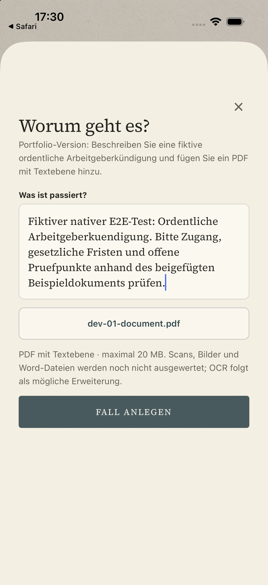
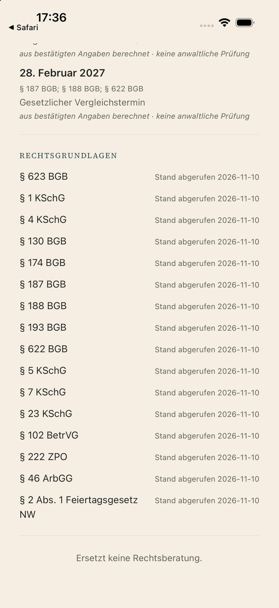
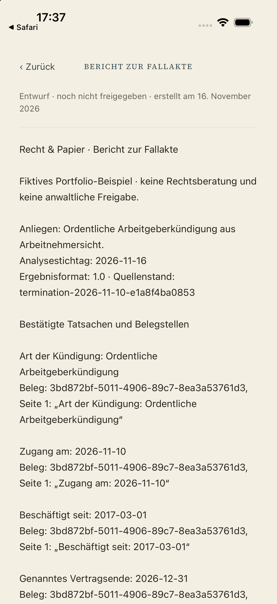
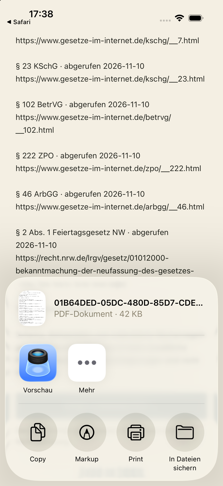

# Nativer Prüflauf vom 16.11.2026

Frischer Release-Build auf einem eigenen iPhone-17-Pro-Simulator mit iOS 26.5,
verbunden mit dem getrennten Supabase-Testprojekt. Die Aufnahmen zeigen die
tatsächlich bediente App mit fiktiven Daten. Testkonto, Fälle, Dateien und
Simulator sind nach dem Nachweis entfernt.

[Maschinenlesbarer Ablauf und Prüfsummen](native-e2e-proof.json) ·
[Build](build-proof.json) · [Serverabgleich](native-server-proof.json) ·
[PDF-Prüfung](native-pdf-proof.json) · [Tatsächliches PDF](2026-11-16-native-export.pdf).

Der vierseitige Export enthält den gesamten bestätigten Bericht und 16 Quellenlinks.
Alle Seiten wurden visuell geprüft. Systemformat US Letter; Absätze können über
Seitenumbrüche weiterlaufen. Simulatornachweis, keine Prüfung eines physischen
Geräts oder der Mailzustellung. Der Build hatte keine Fehler, aber 3.744
Warnungszeilen. Keine freie juristische Modellantwort oder anwaltliche Abnahme.

## Start und Anmeldung

## Original und Belege

## Berechnung und Bericht

