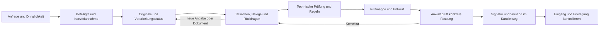

# Recht & Papier: Verbraucher- und Kanzleiprüfung

> Historischer Ausgangsaudit vor der anschließenden Fehlerbehebung. Befunde, Quellstände und ursprüngliche Ausgaben unten beziehen sich auf diesen Vorher-Zustand. Aktuelle Korrekturen, Prüfungen und verbleibende Grenzen stehen im [Korrekturbericht](2026-11-16-remediation.md). Der spätere [isolierte gehostete und native Rollout](2026-11-16-isolated-rollout.md) ist separat geprüft; das bestehende Backend wurde nicht migriert.

Stand: **16.11.2026**. Auftrag: tatsächliche Abläufe gründlich prüfen,
vergleichbare Systeme recherchieren, sinnvolle Entlastung einer Kanzlei
konkretisieren und die Dokumentation aktualisieren.

## Ergebnis zuerst

Recht & Papier besitzt eine gute technische Grundlage für eine **belegte
Fallvorbereitung**: private Originale, strukturierte Angaben, eingefrorene
Eingabestände, kontrollierte Berechnungen, Hintergrundaufträge und Berichte.
Eine Kanzlei kann damit heute aber noch nicht verlässlich bis zur Unterschrift
arbeiten. Es fehlen ein professioneller Reviewpfad, ein bearbeitbarer Entwurf,
eine zusammenhängende Übergabe und mehrere zwingende Sicherheits-/Wahrheitsgrenzen.

Die nächste sinnvolle Produktstufe ist eine **revisionsgebundene anwaltliche
Prüfmappe für einen einzigen Falltyp**. Sie soll Suchen, Nachfragen, Übertragen
und Vorformulieren reduzieren und gezieltes fachliches Prüfen ermöglichen.
Die bestehende ordentliche Arbeitgeberkündigung aus Arbeitnehmersicht ist der
erste Kandidat. Das ist eine vorgeschlagene Entwicklung, keine beschlossene
Erweiterung des freigegebenen Portfolio-Umfangs und keine neue Rechtsfreigabe.

**Wichtigster neuer Befund:** Auch im kontrollierten Pfad ist ein vorhandenes
Originalzitat noch keine hinreichende Garantie für die Richtigkeit des daneben
gespeicherten Werts. Außerdem kann eine historische PDF-Freigabe in der
Exportansicht ohne Prüfung der heutigen Fallrevision weiterverwendet werden.
Diese Grenzen müssen vor einer zuverlässig beworbenen Kanzleiübergabe geschlossen
werden. Der allgemeine LEX-Pfad braucht zusätzlich ein gemeinsames Ausgabegate;
sein formaler Antwortaudit ist kein semantischer Rechtsprüfer.

## 1. Was tatsächlich geprüft wurde

| Prüfstrang | Ergebnis / Artefakt | Reichweite |
| --- | --- | --- |
| Öffentliche Oberfläche | Drei fiktive Fälle bis Ergebnis; sechs neue gespeicherte und geöffnete Screenshots. [Sichtprüfung](2026-11-16-consumer-ux-audit.md) | Echte Browserbedienung der statischen öffentlichen Demo; kein privater Login-/Backendlauf. |
| Öffentliche PDFs | Sechs aktuelle Abrufe HTTP 200, lokal bytegleich; drei Berichte mit je drei vollständig gerenderten und angesehenen Seiten. [Dateiprüfung](2026-11-16-audit/public-pdf-checks.json) | Erreichbarkeit und Darstellung bestehender Artefakte, kein neuer Bericht aus einem echten Fall. |
| Native App, Fallakte, Edge Functions | Typecheck, Schema-/Statusprüfung, 27 Deno-Tests, sechs Function-Typechecks, Bundle-Isolation, 24 Fälle/40 deterministische Ausführungen; gezielte Gegenproben. [App-Audit](2026-11-16-app-casefile-audit.md) | Aktueller Code und isolierte Adapter. Keine erneute Live-RLS-, Löschungs- oder Geräteabnahme. |
| Allgemeine Legal-Engine | 276 bestehende Offline-Tests in 25 Dateien sowie Gegenproben an echten Handlern/Helpers. [Engine-Audit](https://github.com/dreamtelligence/Jura/blob/main/docs/research/2026-11-16-engine-audit.md) | Synthetische Such-/Modellantworten und isolierte Aufrufe; kein bezahltes Modell und kein neuer Live-Index-/Lasttest. |
| Vergleich und Kanzleipraxis | Elf Angebote, 15 Quellenregister-Einträge mit gelesenen Primärquellen. [Marktrecherche](2026-11-16-kanzlei-market-research.md) | Herstellerdokumentation und amtliche/berufsständische Quellen; keine Konkurrenzkonten, Interviews oder gemessene Zeitersparnis. |

Geprüfte lokale Ausgangsstände: Recht-Papier
`2aa167d20f8f4bfa9f977850b30823b73265d109` auf `main`, Jura-Analyse
`eb32db93de3f60bd89d6ab74b51ee9b808136920` auf `fix/async-case-analysis`.
Beide Arbeitsbäume waren anfangs sauber. Jura war fünf Commits vor dem lokalen
Remote-Tracking-Stand; es wurde kein Fetch oder Push zur Publikationsprüfung
ausgeführt. Ein lokaler Quellbefund ist kein Beweis eines aktuellen Livevorfalls.

Die vier Teilberichte trennen ausgeführte Reproduktion, statischen Befund,
historische Evidenz und ungeprüfte Annahme. Erfolgreiche vorhandene Tests und
neu reproduzierte Fehler können gleichzeitig vorliegen: Die Gegenproben
untersuchen bisher nicht vollständig abgedeckte Grenzen.

## 2. Drei verschiedene Produktebenen

1. **Öffentliche Fallstudie:** drei gespeicherte Beispiele für Recruiter, ohne
   persönliche Uploads oder Besucher-Modellkosten. Diesen Umfang bewahren.
2. **Private native Verbraucherakte:** Konto, private Unterlagen, bestätigte
   Angaben, kontrollierter Auftrag und PDF-Gesprächsbericht. Hier liegen die
   neuen App-Befunde und der Ansatzpunkt für einen besseren Eingang.
3. **Allgemeine LEX-Engine:** freier Modelltext und breite Recherche. Deren
   technische und fachliche Grenzen dürfen nicht auf die kontrollierte Akte
   übertragen oder durch deren stärkere Guards verdeckt werden.

Ein **Kanzleimodus ist derzeit ein Zielbild**, keine vierte vorhandene Oberfläche.
Owner-RLS einer persönlichen Akte ist keine professionelle Kanzleimandanten-
trennung. Ein durch den Eigentümer bestätigter Bericht ist keine anwaltlich
freigegebene Fassung. Diese Unterscheidungen müssen auch in Namen, UI und
Dokumentation verständlich bleiben.

## 3. Befunde mit höchster Priorität

Die Priorität richtet sich nach einer Nutzung mit echten Ratsuchenden und
einer zuverlässig beworbenen Kanzleiübergabe. Sie ist keine Einstufung eines
nachgewiesenen Angriffs auf Produktion. Alle folgenden Punkte sind offen;
dieser Audit hat keine Anwendungskorrektur ausgerollt.

| Reihenfolge | Befund | Reproduzierter oder eingegrenzter Nachweis | Erforderliche Grenze |
| --- | --- | --- | --- |
| 1 | **Wert und Zitat widersprechen einander** | A1: Zugangswert um einen Tag geändert, Originalquote unverändert; andere Fristen trotzdem berechnet. | Normalisierbare Wert-/Belegwidersprüche blockieren; Dokumentfakt, Nutzeraussage und fachliche Entscheidung trennen. |
| 2 | **Alte Freigabe wirkt beim PDF-Export aktuell** | A2: Export prüft `approved_at`, nicht die heutige Fallrevision; Detailansicht verliert den Veraltet-Hinweis. | Aktueller Export verlangt aktuellen Snapshot; historische Ausgabe explizit als historisch behandeln. |
| 3 | **Abfragefehler werden leere Abschnitte** | A3: sechs fehlerhafte Kindabfragen liefern eine scheinbar leere Akte. | Fehler und leerer Bestand bleiben verschiedene Zustände; Teilfehler verhindern Vollständigkeitsanzeige. |
| 4 | **Beanstandeter allgemeiner Text wird ausgeliefert** | E01/A8: JSON enthält Text bei `fail`; SSE sendet `token` vor abschließendem Audit. | Zentrales Servergate einschließlich nativer Suche, JSON, SSE und Fallback. |
| 5 | **Audit-Pass wird zu weit verstanden** | E02/E03: falsche Fristaussage mit formal passender Quelle erhält `pass/100`; fehlende Pflichtnorm kann daneben stehen. | Quellen-, Antwort- und Fehlerstatus zusammen prüfen; formale Prüfung nicht als fachliche Freigabe anzeigen. |
| 6 | **Unvollständige Akte kann technischen Pass haben** | A5: zusätzliches ungelesenes PDF ändert den technischen Pass nicht. | Prüfungsumfang und Dokumentvollständigkeit getrennt ausweisen; unberücksichtigte Unterlagen sichtbar halten. |
| 7 | **Dateikompensation und Löschung haben Fehlerpfade** | A4: Storage-Abbaufehler ignoriert; A7: nur erste 1.000 Einträge eines Prefix besucht. | Wiederaufnehmbares Aufräumen und vollständige Bestandsprüfung; keine behauptete Livekontolöschung aus dem Adaptertest. |
| 8 | **Unbekannte Quellenfrische wirkt aktuell** | E04: fehlender Stand wird Tagesdatum; ungültiges Kalenderdatum passiert einen Fallback. | `retrieved_on`, amtlichen Stand und zeitliche Anwendbarkeit getrennt halten; unbekannt bleibt unbekannt. |
| 9 | **Quellenplanung hängt vom Eingang ab** | E05: Verdichtung eines langen Sachverhalts verliert Vollmachtsaspekt und Pflichtnorm. | Fachliche Anforderungen aus vollständigem Snapshot; kompakte Suche darf die Anforderungen nicht ersetzen. |
| 10 | **Unsicherer Renderer für externe Texte** | E10: harmloser Stringnachweis von Attributinjektion und zugelassenem `javascript:`-Link; kein ausgeführter Browserangriff. | Kontextgerechtes Rendering und geprüfte Linkschemata; Modelltext und Quellenmetadaten bleiben untrusted input. |
| 11 | **Vertraulicher Kontext in URL und lokalem Speicher** | E11: freie LEX-Oberfläche bildet GET-Parameter und speichert Gespräche/Falltext lokal; konkrete produktive Aufbewahrung ungeprüft. | Authentifizierter POST, definiertes Speicher-/Löschmodell und kontrollierte Fehler-/Logausgaben. |
| 12 | **Langer Kontext scheitert an eigener Grenze** | E12: 500 Zeichen Kontext plus Frage überschreiten das 500-Zeichen-GET-Limit. | Vorhandenen POST-Pfad und vollständige Anforderungen nutzen; lange gültige Eingaben sichtbar und konsistent behandeln. |

Weitere konkrete Befunde stehen in den Teilberichten: Dokument-Fortschritt und
Retry, gestufte Rückfragen ohne geführten Antwortloop, Eingabevalidierung,
Ergebniszustellung, rechtsspezifische Quellenabdeckung und sicherer Umgang mit
extern erzeugten Inhalten. Die Prioritäten sind keine Einladung zu einem
gleichzeitigen Großumbau: jede gemeinsame Grenze einzeln reproduzieren,
korrigieren und danach erneut prüfen.

## 4. Aus Sicht eines Ratsuchenden

Die Ausgangslage ist häufig ein unverständlicher Brief, Unsicherheit über den
Erhalt und der Wunsch zu wissen, was jetzt als Nächstes zu tun ist. Eine
technische Faktmaske darf diese Übersetzungsarbeit nicht vollständig beim
Nutzer abladen.

### Vorgeschlagener erster vollständiger Verbraucherablauf

1. **Anliegen und Dringlichkeit:** Welches Schreiben, wann tatsächlich erhalten,
   welches Ziel? Unbekannter Zugang führt zu einer konkreten Rückfrage und
   erkennbarer menschlicher Hilfe, nicht zu einem geratenen Datum.
2. **Unterlagen sammeln:** Originalbrief, Vertrag/Nachträge und relevante
   weitere Dokumente. Fotos/Scans entweder verständlich ablehnen oder in einem
   gesondert abgenommenen OCR-Pfad bearbeiten; „hochgeladen“ bedeutet nicht
   „vollständig verstanden“.
3. **Vorschläge prüfen:** Vorhandene Angaben übernehmen, Originalpassage neben
   dem Wert zeigen, Korrektur und „weiß ich nicht“ erlauben. Eigene Erinnerung
   an den Zugang ist eine Nutzeraussage, kein fingierter Briefbeleg.
4. **Klärungen beantworten:** Eine priorisierte nächste Frage plus verbleibende
   Checkliste. Bereits beantwortete Fragen bleiben beantwortet; ein Gegenbeleg
   bleibt sichtbar. Betroffene Berechnungen werden nach einer Änderung neu bewertet.
5. **Empfänger und Auftrag verstehen:** Vor Weitergabe erkennen, welche
   Kanzlei welche Daten erhält. Anfrage, eingegangen, angenommen und in
   Bearbeitung sind tatsächliche verschiedene Zustände. Upload bedeutet weder
   Vertretung noch Fristwahrung.
6. **Kosten und Rückmeldung:** Leistungsumfang, mögliche Kosten und echte
   Antworterwartung vor Beauftragung benennen. Keine übernommenen
   Konkurrenzversprechen wie „kostenlos“ oder „in zwei Stunden“ ohne eigene
   Leistung und Bedingungen.
7. **Nachreichen und Ergebnis mitnehmen:** Ergänzungen derselben Akte zuordnen,
   Status und offenen Bearbeitungsschritt sehen; nachvollziehbare aktuelle
   Unterlagen exportieren und Löschung/Aufbewahrung verstehen.

Belegte Vergleichsmuster: [advocado](https://www.advocado.de/wie-es-funktioniert.html)
trennt Ersteinschätzung und spätere Beauftragung;
[Flightright](https://www.flightright.de/faq) dokumentiert Nachreichen, Kosten
und Status in einem engen Falltyp. Daraus folgt keine Zusage, dass unser
Produkt schon dieselben Leistungen erbringt.

## 5. Was die Kanzlei als Arbeitsprodukt erhalten sollte

### Inhalt einer konkreten Prüfmappe

| Teil | Vorbereitete Arbeit | Gezielte anwaltliche Kontrolle |
| --- | --- | --- |
| Übersichtsblatt | Anliegen/Ziel, Beteiligte, Dringlichkeit, Mandatsstatus, aktuelle Revision, offene Pflichtpunkte. | Zuständigkeit, Interessenkollision, Annahme, nächster Schritt und Strategie. |
| Dokumentenregister | Originale, Namen, Typen, Seiten, Hashes, Verarbeitung/OCR, unlesbare oder fehlende Teile. | Echtheit, Relevanz und Vollständigkeit; keine stillschweigend ignorierten Anlagen. |
| Tatsachen-/Zeitachse | Ereignis, Wert, Quelle/Seite/Quote, Nutzeraussage, Gegenbeleg, Unsicherheit. | Welche Tatsachen zugrunde gelegt oder bestritten werden und welche Beweise fehlen. |
| Prüftabelle | Pro Rechtsfrage: Voraussetzungen, passende Quellenfassung, Vorschlag, Gegenargumente, offene Frage. | Anwendbarkeit, Schlussfolgerung und weitere fachliche Recherche. |
| Berechnungsblatt | Unterstützte deterministische Regeln, Eingabewerte, Annahmen, Kalendergrenze. | Frist und Zuständigkeit bestätigen; Sonderregeln prüfen; in Kanzleikontrolle übernehmen. |
| Bearbeitbarer Entwurf | Enger Vorlagentyp mit belegten Daten, offenen Stellen und geordneten Anlagen. | Gesamten Text, Anträge, Adressaten, Argumentation, Kosten-/Verfahrensrisiken prüfen. |
| Prüf- und Ausgangsvermerk | Wer welche Fassung wann geprüft hat, relevante Änderungen seit Review, Exportstand. | Konkrete Fassung freigeben, Unterschrift/Versand verantworten, tatsächlichen Eingang kontrollieren. |

Die Kanzlei sollte aus einer Behauptung direkt zum Original springen können.
Eine Änderung muss zeigen, welche Berechnung, Passage und frühere Prüfung sie
betrifft. Ein mitgelieferter Prüfhinweis ersetzt keinen verantwortlichen Prüfer.

Die bestehenden Strukturen werden weiterverwendet: `cases`, Originaldokumente,
strukturierte Eingabe, `input_revision`, Analyse-Snapshot, Resultatvertrag und
Bericht. Zusätzlich benötigte Beteiligten-, Aufgaben-, Rollen- und Reviewdaten
sind **geplante Erweiterungen**. Ein zweiter Chat-Datenspeicher mit abweichender
Fallwahrheit wäre keine sinnvolle Abkürzung.

### Vorgeschlagener Ablauf mit menschlicher Freigabe

Das Diagramm beschreibt das Ziel. Die vorhandene Software endet derzeit beim
kontrollierten persönlichen Gesprächsbericht. Es behauptet keine vorhandene
Kollisionsprüfung, Kanzleiannahme, DOCX-Erzeugung oder Gerichtsübermittlung.

### „Nur noch unterschreiben“ technisch präzisiert

Das sinnvolle Ziel ist möglichst wenig Such-, Sammel- und Übertragungsarbeit
bei einer vollständig prüfbaren Grundlage. Die Prüfung der rechtlichen
Ausführungen, Quellen und Strategie bleibt der verantwortlichen Person.
Der [aktuelle BRAK-Hinweis](https://www.brak.de/newsroom/newsletter/nachrichten-aus-berlin/2026/ausgabe-23-2026-v-11112026/kuenstliche-intelligenz-in-anwaltskanzleien-brak-hinweise-aktualisiert/)
ordnet den KI-Einsatz ausdrücklich in eigenverantwortliche Endkontrolle,
Verschwiegenheit und Dienstleisterprüfung ein. Der Marktbericht verlinkt den
zugehörigen Leitfaden und die Signaturhinweise des beA-Supports.

Ein Finger-/Formularsignaturfeld ist keine automatisch passende gerichtliche
Signatur oder ein Einreichungsnachweis. Für arbeitsgerichtliche anwaltliche
Einreichungen ist zudem [§ 46g ArbGG](https://www.gesetze-im-internet.de/arbgg/__46g.html)
zu beachten. Export, Signatur, Versand und Eingang müssen eigene Status sein.
Ein eigener beA-Client ist deshalb keine Voraussetzung des ersten Pakets.

## 6. Technische Leitplanken für die vorgeschlagene Stufe

### Wahrheit, Vollständigkeit und Freigabe auseinanderhalten

- **Dokument gespeichert:** Original vorhanden, noch keine Aussage über Lesbarkeit.
- **Text verarbeitet:** technische Extraktion abgeschlossen; OCR-Qualität,
  fehlende Seiten und Originalbezug separat sichtbar.
- **Fakt vorgeschlagen:** maschinelle Zuordnung mit Herkunft, noch nicht bestätigt.
- **Fakt bestätigt:** eine benannte Person bestätigt eine Aussage; fachliche
  Einordnung und Authentizität werden dadurch nicht automatisch wahr.
- **Technisch geprüft:** konkreter Vertrag/Regeln/Quellenstatus für einen Snapshot.
- **Fachlich geprüft:** berechtigter Anwalt hat definierte Punkte auf dieser
  Fassung geprüft; offene Bedingungen bleiben sichtbar.
- **Ausgangsfassung freigegeben:** genau dieses Dokument mit diesem Hash und
  Prüfstand; keine nachträgliche Änderung unter unverändertem Freigabestempel.
- **Übermittelt/eingegangen:** echter Kanalnachweis, unabhängig vom Download.

Diese Begriffe sind ein Anforderungsmodell. Eine zukünftige Migration muss
bestehende `approved_at`-Werte als mandantenseitige historische Bestätigung
einordnen, sie niemals rückwirkend zu anwaltlicher Freigabe umdeuten.

### Weitergabe und Kanzleiberechtigung

Für den ersten echten Kanzleipfad eine ausdrückliche Einladung/Zuordnung und
begrenzte Aktenrollen vorsehen. Rechte je Akte und Kanzlei serverseitig prüfen;
`service_role` ist kein Benutzerrollenmodell. Widerruf, Bearbeiterwechsel,
falsche Fall-ID, Fremdkanzlei und Linkweitergabe gehören in die Tests. Ein
kurzlebiger Signed-URL ist während seiner Laufzeit ein weitergebbarer Zugang.
Aus ihm keine Empfängerautorisierung ableiten.

Interessenkollision vor Mandatsannahme auf Basis erfasster Beteiligter
vorbereiten; unvollständige Namen dürfen keinen Status „kollisionsfrei“
erzeugen. Berufsrechtliche Grundlage ist
[§ 43a BRAO](https://www.gesetze-im-internet.de/brao/BJNR005650959.html),
Dienstleister- und Geheimnisschutz sind gesondert nach
[§ 43e BRAO](https://www.gesetze-im-internet.de/brao/__43e.html) zu prüfen.
Mandatsvollmacht, Weitergabeberechtigung und Datenverarbeitung sind verschiedene
Sachverhalte; keine einzige Checkbox darf sie pauschal gleichsetzen.

Für einen eigenständigen Verbraucher-Rechtsdienst gelten außerdem
[§ 2 RDG](https://www.gesetze-im-internet.de/rdg/__2.html) und
[§ 3 RDG](https://www.gesetze-im-internet.de/rdg/__3.html).
Welche konkrete erlaubte Leistung angeboten werden soll, ist vor Betrieb
fachlich zu klären. Ein Disclaimer allein entscheidet diese Einordnung nicht.
Diese Recherche enthält keine rechtliche Abnahme des Geschäftsmodells.

### Bestehenden Stack nutzen

Für die belegten nächsten Pakete ist kein Anbieterwechsel begründet.
Expo/React Native, Supabase und Python/Modal können zunächst erhalten bleiben.
Die Ursachen liegen in Freigabeentscheidungen, Herkunft, Revisionen, Fehlerfällen
und Übergabe, nicht in einer gemessenen Kapazitätsgrenze. Eine spätere
Infrastrukturentscheidung würde aktuelle Preise, Datenflüsse, Verträge,
Last und Rückweg separat vergleichen; das wurde hier nicht vorweggenommen.

Bei vertraulichen Akten die tatsächlichen Empfänger und Datenflüsse erfassen,
Protokolle minimieren, Dokumentinhalte als untrusted input behandeln und
Zugangsdaten nicht in Prompts/Clients aufnehmen. Ein EU-Label und ein
vorgegebener Modellname ersetzen weder diese Prüfung noch Anbietervereinbarungen.

## 7. Konkreter Arbeitsplan mit Abnahmen

Die Pakete sind eine Empfehlung für folgende Aufträge. Der Audit baut sie
nicht stillschweigend und ändert keine bestehende Produktionsfreigabe.

| Paket | Ergebnis | Abnahmekriterien |
| --- | --- | --- |
| **A · Herkunft und aktuelle Fassung** | Belegte Werte, Nutzerbehauptungen und historische Berichte bleiben unterscheidbar. | A1/A2/A3-Gegenproben gehen nach Korrektur nicht mehr durch; widersprechender Wert wird blockiert/als eigener Konflikt erfasst; Revision ändert aktuelle Exportfähigkeit; Ladefehler erscheinen nicht leer. |
| **B · Gemeinsame allgemeine Ausgabesperre** | Ein Statusvertrag für alle freien Enginewege. | E01–E03: fail/null/Fehler/fehlende Pflichtnorm blockieren Modelltext in JSON, SSE, nativem Proxy und jedem Fallback; formaler Pass wird nicht fachliche Freigabe. Sicheres Rendering und Fehlerausgaben separat prüfen. |
| **C · Verlässlicher Dokumenteingang** | Mehrere Originale, klare Zustände, sichere Wiederholung und Bereinigung. | Unlesbares relevantes Dokument verhindert Vollständigkeitsstatus; Netzwerkverlust/Wiederaufnahme, Rollbackfehler, 1.001 Objekte und Wiederholung kontrolliert getestet. |
| **D · Geführte Klärung** | Priorisierte Fragen und gezieltes Nachreichen für den engen Falltyp. | Zugangsfrage ohne Dokumentfälschung beantworten; bekannte Fakten nicht erneut abfragen; alle offenen Abhängigkeiten sichtbar; neue Antwort invalidiert betroffene Ergebnisse. |
| **E · Kanzlei-Prüfmappe** | Eine berechtigte Kanzlei prüft eine konkrete Fassung. | Zwei Personen und Fremdrolle in isolierter Umgebung; belegte Tatsachenmatrix, Originalsprung, Aufgaben, Deltas, Freigabe-/Widerrufsprüfung und auswertbarer Verlauf. |
| **F · Bearbeitbarer Entwurf und Export** | Ein enger Vorlagentyp plus Original-/Anlagenpaket. | Keine erfundenen Daten; bearbeitbarer Text, Quellen und Anlagen passen zur Revision; geänderte Fassung erfordert neue Freigabe; keine behauptete Einreichung durch Download. |
| **G · Vergleichende Kanzleiabnahme** | Nachweis, ob tatsächlich Arbeit entfällt. | Fachlich definierte Akten, kontrollierter Vergleich mit bisherigem Vorgehen, vollständige Fehler-/Korrekturzeiten und keine kritischen übersehenen Punkte im abgenommenen Set. |

Der erste technische Schritt ist **Paket A**, begleitet von **Paket B** als
eigener gemeinsamer Enginegrenze. Der erste sichtbare Produktgewinn folgt in
C/D. Erst danach lohnt ein professionell wirkendes Reviewportal: Eine schöne
Prüfmaske darf falsche Herkunft oder einen alten Freigabestand nicht verdecken.

## 8. Wie der Arbeitsgewinn gemessen wird

Vor einem Test fachlich festlegen: Falltyp, unterstützte Ausnahmen,
Referenzentscheidung, kritische Fehler und erlaubte Hilfsmittel. Danach
dieselben Arten von Akten einmal im bisherigen Ablauf und einmal mit Mappe
bearbeiten; Reihenfolge variieren und aktive Bearbeitungszeit einschließlich
Korrektur dokumentieren. Einige fiktive Akten sind ein Machbarkeitstest,
keine statistische Aussage über alle Kanzleien.

Zu messen sind insbesondere:

1. Minuten bis zu einem fachlich akzeptierten Entwurf, einschließlich Nachlesen
   und Nacharbeit; Modelllatenz allein zählt nicht als Entlastung.
2. Vermeidbare Rückfragen und doppelte Dateneingaben.
3. Fehlende/übersehene Unterlagen und falsch zugeordnete Tatsachen.
4. Richtigkeit und Nachvollziehbarkeit von Quellen/Fristen im freigegebenen Umfang.
5. Änderungen, die eine alte Freigabe nicht korrekt ungültig machen.
6. Zeit für Originalbeleg-/Fundstellenprüfung und Zahl falscher Links.
7. Fehler bei Export/Import, Anlagenreihenfolge und Aktenzuordnung.
8. Subjektive Verständlichkeit für Ratsuchende und Prüfbelastung für Kanzleipersonal.

Keine prozentuale Einsparung wurde in diesem Audit gemessen. Null kritische
Fehler im festgelegten Abnahmesatz ist ein gewünschtes Gate, keine Behauptung
einer bereits erreichten allgemeinen Fehlerfreiheit. Verantwortliche Anwälte
müssen den fachlichen Goldstandard und den Umfang ihrer Abnahme bestimmen.

## 9. Dokumentationsstand nach diesem Auftrag

Aktualisiert werden Einstieg, Dokumentationsindex, Architekturgrenzen,
Release-Status, Review-Briefing und die gemeinsame Engine-Gate-Spezifikation.
Die Berichte vom 10./11.11. bleiben als historische Messungen erhalten und
werden nicht rückwirkend durch neue Testzahlen ersetzt. Neue Befunde erhalten
Datum, Quellstand und explizite Abnahmegrenzen.

Die im alten Agent Guide genannten Semantica-IDs `product:recht-und-papier`,
`domain-model:legal-case-file`, `architecture:recht-und-papier-core` und
`compliance:recht-und-papier` ließen sich in diesem Lauf nicht direkt laden.
Relevante Entscheidungen wurden stattdessen gezielt über die vorhandenen
Kategorien und den Knoten `recht-papier-gap-review-2026-11-11` gelesen. Fehlende
Knoten sind kein Beleg für fehlende Implementierung. Die geprüften neuen
Erkenntnisse werden im aktuellen Graph mit Berichtsverweisen festgehalten.

## 10. Offene Grenzen

Keine neue Anmeldung/Analyse echter Nutzer, keine produktive Datenmutation,
kein Deployment/Push, keine bezahlte Inferenz, kein neuer Vollkorpusabruf,
kein beA-Versand und keine tatsächliche anwaltliche Endkontrolle. Native
Gerätebedienung, heutige produktive RLS-/Grant-Konfiguration, vollständige
Wiederherstellung, Last, Betriebskosten und Datenschutz-/Vertragsabnahme
bleiben gesonderte Prüfungen. Öffentliches Demo-Verhalten, lokale Quellen und
geprüfte isolierte Fehlerpfade sind genau die hier vorliegenden Nachweise.
